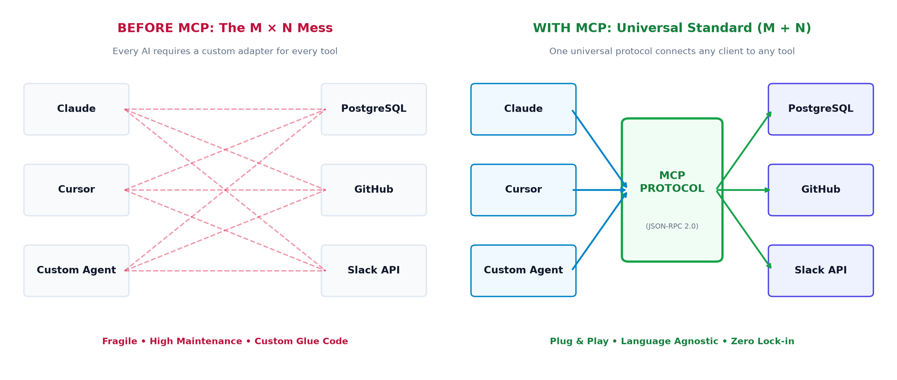
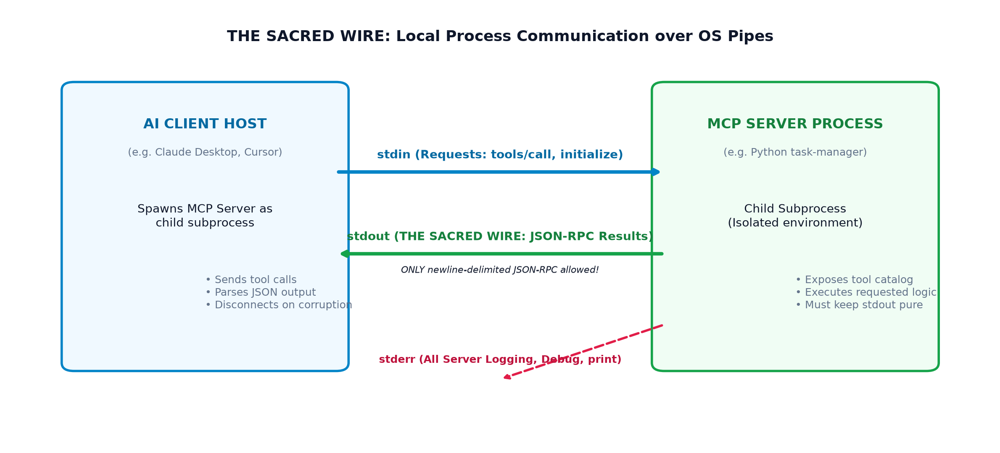
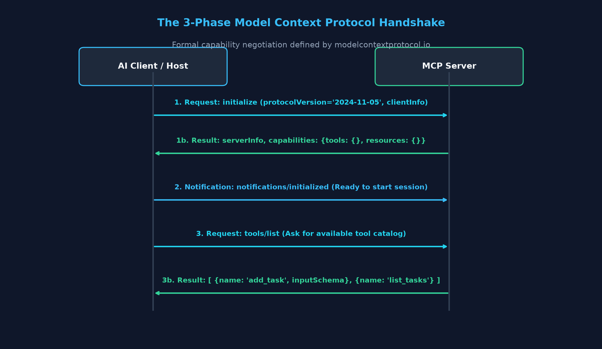
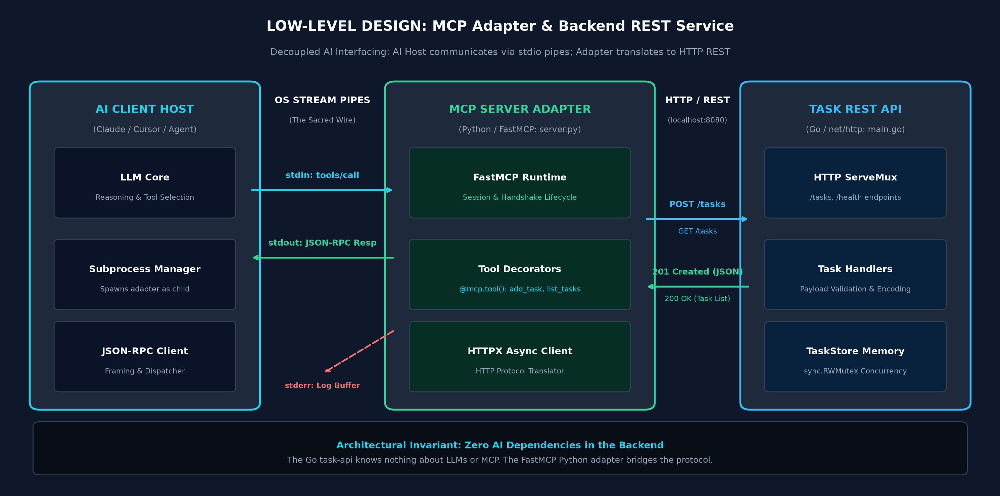

<p align="center">
  
</p>

## Introduction — The USB-C Moment for Artificial Intelligence

Remember the nightmare of proprietary laptop chargers a decade ago? 

Every laptop brand had its own charging port. If you carried a Dell, a ThinkPad, and a MacBook, you needed three different bulky adapters. Then came **USB-C**: one universal plug, one open specification, and suddenly every phone, laptop, and monitor spoke the same electrical language.

In the world of Artificial Intelligence, developers have been living in that exact same proprietary mess.

If you wanted Claude to talk to your PostgreSQL database, you had to write custom function-calling wrappers. If you wanted Cursor to talk to that same database, you wrote another tool plugin. If you switched to an internal agent, you started over from scratch.

<p align="center">
  
</p>

The **[Model Context Protocol (MCP)](https://modelcontextprotocol.io/)** is the USB-C cable for AI. 

Maintained as an open standard by Anthropic and the open-source community, MCP standardizes how any AI model connects to data sources, local files, developer tools, and backend microservices. In this first part of our engineering series, we explore how an AI host and a local program introduce themselves over the wire—and why a single `print()` statement can accidentally crash the entire connection.

---

## The Core Problem — Why Not Just Traditional REST APIs

A common question systems engineers and developers ask when first reading the [official MCP specification](https://modelcontextprotocol.io/specification):

> *"We already have HTTP REST APIs and JSON. Why not just pass an OpenAPI schema to the LLM instead of inventing a whole new protocol?"*

While REST APIs are excellent for standard client-server web apps, they fall short for local AI agent orchestration due to three fundamental architectural gaps:

1. **REST is Stateless and Unidirectional:** An HTTP client asks for data, the server answers, and the socket closes. Traditional REST has no built-in bidirectional event loop for an AI editor (like Cursor or Claude Desktop) to negotiate sessions, push real-time progress notifications, or handle stateful tool interruptions.
2. **Missing Capability Negotiation:** When an AI connects to an external tool, how does it know whether the server supports dynamic resource subscriptions, prompt templates, or streaming outputs? The [MCP Architecture](https://modelcontextprotocol.io/introduction) includes a formal handshake where client and server exchange explicit capability flags before any tool is ever called.
3. **Local Process Sandboxing (Zero Open Ports):** When an AI desktop app runs on your machine, spinning up a local HTTP web server listening on `http://localhost:8080` introduces open-port attack vectors on developer workstations. MCP solves this by communicating directly over **operating system process pipes (`stdio`)**, requiring zero open network ports.

---

## The Sacred Wire — Standard Input and Standard Output

When you run a local MCP server, it does not listen on a network socket. Instead, the AI application (the Client / Host) spawns your script as a **child process** and hooks directly into its standard operating system file descriptors:

<p align="center">
  
</p>

* **Standard Input (`stdin`):** The AI Client writes line-delimited JSON-RPC 2.0 requests into your program's input stream.
* **Standard Output (`stdout`):** Your program writes line-delimited JSON-RPC 2.0 responses back to the AI Client.
* **Standard Error (`stderr`):** Your program sends human-readable diagnostic logs to the terminal or host console.

### The Mystery of the Broken Client

Here is a rite of passage every engineer faces when building their first MCP adapter:

You write a tool to create a record. You add an innocent debugging statement:
```python
print("Connecting to backend database...")
```
Instantly, your AI client disconnects with a fatal JSON parsing error. What happened?

> **Mental Model: The Sacred Wire**  
> In local `stdio` transport, `stdout` is the sacred wire. The MCP client expects every single line on `stdout` to be a strictly valid JSON-RPC 2.0 message ending with a newline (`\n`). When you call `print()`, Python writes raw text directly to `stdout`, corrupting the JSON-RPC framing. Diagnostic logging must be routed exclusively to `stderr`.

---

## The Three-Phase Handshake — How Programs Introduce Themselves

Before an AI can ask your server to do anything, the protocol mandates a **Three-Phase Connection Handshake** as defined in the [MCP Lifecycle Specification](https://modelcontextprotocol.io/specification/architecture#lifecycle):

<p align="center">
  
</p>

### Phase 1: The Greeting (`initialize`)
The client sends an `initialize` request over `stdin`. It shares its protocol version (e.g. `"2024-11-05"`) and client metadata:
```json
{
  "jsonrpc": "2.0",
  "id": 1,
  "method": "initialize",
  "params": {
    "protocolVersion": "2024-11-05",
    "capabilities": {},
    "clientInfo": { "name": "cursor-client", "version": "1.0.0" }
  }
}
```
The server responds on `stdout` with its name, version, and supported capability map (e.g., `{"tools": {}, "resources": {}}`).

### Phase 2: The Acknowledgment (`notifications/initialized`)
The client acknowledges with a one-way JSON-RPC notification:
```json
{
  "jsonrpc": "2.0",
  "method": "notifications/initialized"
}
```
Because this is a notification (no `"id"` field), the server does not send a response. Both processes are now officially connected.

### Phase 3: The Catalog Discovery (`tools/list`)
Now that the session is established, the client queries what functions are available:
```json
{
  "jsonrpc": "2.0",
  "id": 2,
  "method": "tools/list"
}
```
The server responds with an array of tools, complete with their **JSON Schema** parameter contracts. The LLM reads these schemas to decide when and how to call your tools.

---

## Production Implementation — Building an MCP Server Adapter

In enterprise environments, an MCP server is rarely a standalone toy with hardcoded responses. It is an **adapter** that safely bridges an AI assistant to existing backend systems.

> **Mental Model: What is an MCP Server Really?**  
> * **MCP Server** = Traditional Backend Service + MCP Adapter  
> * **MCP Adapter** = Traditional API Client + MCP Protocol Contract (Tools, Resources, Prompts)  
>
> You do not rewrite your enterprise backend for AI. The underlying service remains an ordinary REST or gRPC microservice. The MCP adapter simply exposes it to the model by translating standard JSON-RPC tool calls into internal API requests.

<p align="center">
  
</p>

To keep our focus strictly on the protocol, our Python adapter connects to a background Task REST API on `http://localhost:8080`. *(If you want to run the companion backend service locally, the complete runnable code and setup guide are hosted in [assets/task-api](https://github.com/ashok-murugan/ashok-murugan-blogs/tree/main/mcp-part-1-the-first-handshake/assets/task-api)).*

---

### The Python FastMCP Adapter (`server.py`)

The official Python SDK provides a high-level, declarative framework called **FastMCP**, detailed extensively in the official documentation:
* **[Official MCP Server Quickstart](https://modelcontextprotocol.io/quickstart/server)**: Step-by-step tutorial for building a server in Python.
* **[Official Python SDK Repository](https://github.com/modelcontextprotocol/python-sdk)**: Core SDK code, FastMCP implementation, and type definitions.
* **[MCP Architecture & Server Concepts](https://modelcontextprotocol.io/docs/concepts/servers)**: The formal specification of server lifecycles, capability maps, and protocol states.
* **[Tools Protocol Specification](https://modelcontextprotocol.io/docs/concepts/tools)**: How tools are declared, schema-validated, and invoked by LLMs.
* **[Transports Specification](https://modelcontextprotocol.io/docs/concepts/transports)**: Mechanics of `stdio` OS pipes vs remote `sse` transports.
* **[MCP Inspector Debugger](https://modelcontextprotocol.io/docs/tools/inspector)**: Official web developer tool to test and inspect your server without configuring an IDE.

Below is the asynchronous Python MCP server that bridges an AI agent to the Go REST API:

```python
# server.py
import os
import sys
from typing import Optional
import httpx
from mcp.server.fastmcp import FastMCP

API_BASE = os.environ.get("TASK_API_BASE", "http://localhost:8080")

# 1. Initialize FastMCP Server with lifecycle management
# Official Docs: https://modelcontextprotocol.io/quickstart/server#creating-a-server
mcp = FastMCP(
    name="task-manager",
    instructions="Production task manager adapter. Supports creating and listing tasks."
)

# 2. Expose Tool: add_task
# Official Docs: https://modelcontextprotocol.io/docs/concepts/tools
@mcp.tool()
async def add_task(title: str) -> str:
    """
    Create a new task in the corporate task manager.

    Args:
        title: The descriptive title of the task to create.
    """
    # ⚠️ PROTOCOL RULE: Log exclusively to stderr to avoid stdout corruption!
    sys.stderr.write(f"[Server Log] Creating task: {title}\n")
    sys.stderr.flush()

    async with httpx.AsyncClient() as client:
        resp = await client.post(f"{API_BASE}/tasks", json={"title": title}, timeout=5.0)
        resp.raise_for_status()
        task = resp.json()
        return f"Task #{task['id']} created: '{task['title']}' [status: {task['status']}]."

# 3. Expose Tool: list_tasks
# Official Docs: https://modelcontextprotocol.io/docs/concepts/tools
@mcp.tool()
async def list_tasks(status: Optional[str] = "ALL") -> str:
    """
    Retrieve tasks from the task manager filtered by status.

    Args:
        status: Filter criteria: ALL, PENDING, or COMPLETED.
    """
    sys.stderr.write(f"[Server Log] Querying tasks with filter: {status}\n")
    sys.stderr.flush()

    async with httpx.AsyncClient() as client:
        params = {} if not status or status == "ALL" else {"status": status.upper()}
        resp = await client.get(f"{API_BASE}/tasks", params=params, timeout=5.0)
        resp.raise_for_status()
        tasks = resp.json()

        lines = [f"#{t['id']} [{t['status']}] {t['title']}" for t in tasks]
        return "\n".join(lines) if lines else "No tasks found."


if __name__ == "__main__":
    # Start listening over standard I/O OS pipes
    # Official Docs: https://modelcontextprotocol.io/docs/concepts/transports#stdio
    mcp.run(transport="stdio")
```

### Official SDK Architecture and Documentation Guide

The code above demonstrates the standard patterns documented in the official [modelcontextprotocol.io](https://modelcontextprotocol.io/) specification:

1. **Declarative Server Lifecycle ([FastMCP Quickstart](https://modelcontextprotocol.io/quickstart/server)):**  
   Calling `FastMCP("task-manager")` instantiates the session manager. As explained in the [Server Concepts Documentation](https://modelcontextprotocol.io/docs/concepts/servers), it encapsulates capability negotiation, message routing, and graceful shutdown loops without requiring manual JSON-RPC dispatch tables.
2. **Dynamic Tool Schema Reflection ([Tools Concept Guide](https://modelcontextprotocol.io/docs/concepts/tools)):**  
   When decorating functions with `@mcp.tool()`, the SDK inspects your function signature, type annotations (`title: str`, `status: Optional[str]`), and docstring. As documented in the [Tools Specification](https://modelcontextprotocol.io/docs/concepts/tools), FastMCP automatically converts them into an OpenAPI/JSON-Schema-compliant parameter definition returned during the `tools/list` handshake.
3. **Transport Stream Binding ([Transports Specification](https://modelcontextprotocol.io/docs/concepts/transports#stdio)):**  
   Calling `mcp.run(transport="stdio")` attaches the server to the process's standard input and output streams using asynchronous readers (`anyio`), strictly adhering to line-delimited JSON-RPC framing.
4. **Interactive Verification with the MCP Inspector ([Inspector Guide](https://modelcontextprotocol.io/docs/tools/inspector)):**  
   You can test this server directly in your browser without configuring an IDE client by running:
   ```bash
   npx @modelcontextprotocol/inspector python server.py
   ```
5. **Decoupled Architecture:**  
   The underlying backend service remains an ordinary REST/gRPC microservice; the MCP adapter simply exposes it safely and dynamically to any AI client.

---

### Runnable Source Code and GitHub Assets

To make this codebase modular and easy to track as we progress through the series, every article in this 5-part guide maintains its own dedicated assets folder on GitHub.

👉 **[Explore the Part 1 Assets & Runnable Code on GitHub](https://github.com/ashok-murugan/ashok-murugan-blogs/tree/main/mcp-part-1-the-first-handshake/assets)**

The assets directory contains:
* `task-api/`: Full Go REST API source code (`main.go`, `go.mod`) with zero external dependencies.
* `server.py`: Complete Python FastMCP stdio server adapter.
* `requirements.txt`: Python package specifications.
* `lld-architecture.png`: Full architectural Low-Level Design diagram.
* `README.md`: Step-by-step instructions on compiling the Go backend, launching the adapter, and inspecting tools with the MCP Inspector.

---

## Conclusion

The Model Context Protocol establishes the fundamental foundation for agentic AI engineering:

* **Open USB-C Standard:** Solves the $M \times N$ fragmentation problem across AI clients and enterprise data sources.
* **Process Sandboxing:** Uses OS `stdio` pipes to run tools locally on developer machines without opening vulnerable network ports.
* **The Sacred Wire:** Keeps `stdout` strictly reserved for newline-delimited JSON-RPC frames while routing all diagnostics to `stderr`.
* **The 3-Phase Handshake:** Negotiates capabilities upfront before exposing tool schemas dynamically to the LLM.

Now that our AI knows how to shake hands and discover tools over the wire, what kind of capabilities can it expose?

In **Part 2: Hands, Eyes, and Recipes**, we explore the three core primitives defined by [modelcontextprotocol.io](https://modelcontextprotocol.io/)—**Tools**, **Resources**, and **Prompts**—and why treating every data source as a tool is a dangerous anti-pattern.
