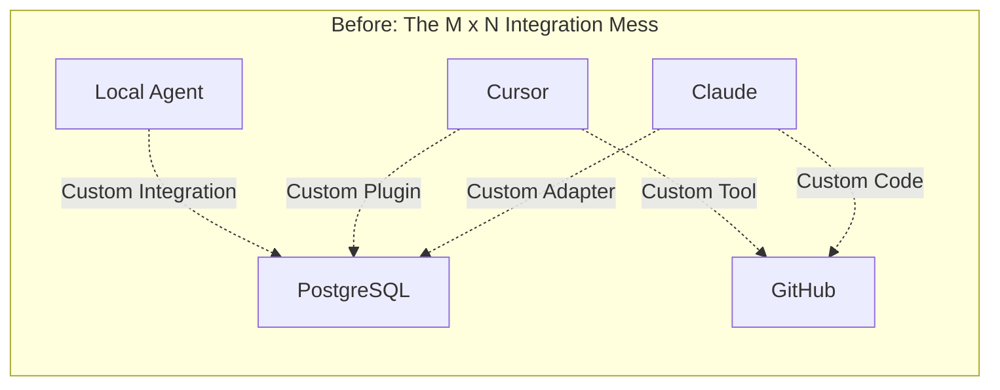
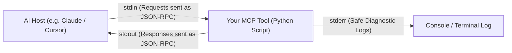
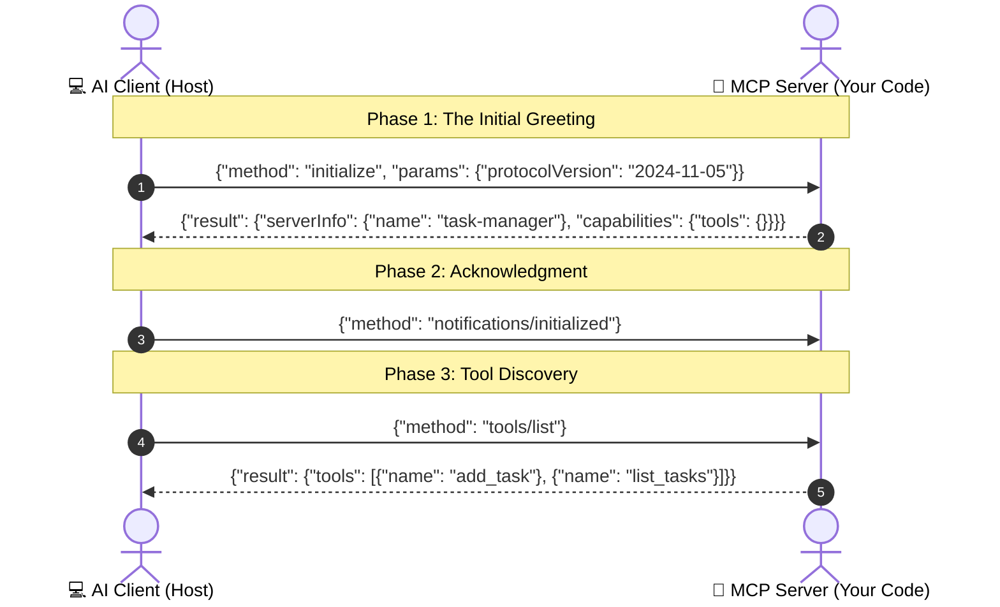

<p align="center">
  
</p>

## Introduction — The USB-C Moment for Artificial Intelligence

Remember the nightmare of laptop chargers a decade ago? 

Every laptop brand had its own proprietary charging barrel. If you carried a Dell, a ThinkPad, and a MacBook, you needed three different bulky bricks. Then came **USB-C**: one universal plug, one open standard, and suddenly every phone, laptop, and monitor spoke the same electrical language.

In the world of Artificial Intelligence, we have been living in that exact same proprietary nightmare.

If you wanted Claude to talk to your PostgreSQL database, you had to write custom function-calling wrappers. If you wanted Cursor to talk to that same database, you wrote another tool adapter. If you switched to an internal agent, you started over from scratch.



The **Model Context Protocol (MCP)** is the USB-C cable for AI. 

It standardizes how any AI model connects to any tool or database, anywhere. In this first part of our series, we will look at how two programs actually introduce themselves over the wire—and why a single `print()` statement can accidentally crash the entire system.

---

## The Core Problem — Why Not Just Traditional REST APIs

A common question college students and junior engineers ask is:

> *"We already have HTTP REST APIs and JSON. Why did Anthropic invent a whole new protocol instead of just using OpenAPI?"*

The answer comes down to three fundamental limitations of traditional REST:

1. **REST is One-Way and Stateless:** An HTTP client asks for data, the server answers, and the connection closes. REST has no native way for a local tool to maintain an active bidirectional session with an AI editor.
2. **Missing Capability Negotiation:** When an AI connects to your database, how does it know what operations are safe? How do they agree on protocol versions? Traditional REST has no built-in handshake for dynamic capability negotiation.
3. **Process Sandboxing:** In desktop tools like Cursor or Claude Desktop, the AI needs to spin up a helper script locally on your laptop **without exposing open network ports** to the public internet. REST requires listening on a network port, which creates security vulnerabilities on developer machines.

MCP solves all three problems by running over a lightweight wire protocol called **JSON-RPC 2.0**.

---

## The Sacred Wire — Standard Input and Standard Output

When you run an MCP server on your local machine, it does not open a web port like `http://localhost:8080`. Instead, the AI application (the Client) launches your script as a **child process** and connects directly to its operating system pipes:



* **Standard Input (`stdin`):** The client types JSON-RPC commands into your script.
* **Standard Output (`stdout`):** Your script sends JSON-RPC responses back to the client.
* **Standard Error (`stderr`):** Your script prints human-readable debugging logs.

### The Mystery of the Broken Client

Here is a rite of passage every engineer faces when building their first MCP server:

You write a tool to fetch tasks. You add a innocent debugging line:
```python
print("Fetching tasks from database...")
```
Suddenly, your AI client crashes with a fatal JSON deserialization error. What happened?

> **Mental Model: The Sacred Wire**  
> In local `stdio` mode, `stdout` is the sacred protocol wire. The client expects every single line on `stdout` to be a valid JSON-RPC object ending with a newline (`\n`). When you call `print()`, you inject plain English text directly into the wire, corrupting the stream. Diagnostic logging belongs exclusively on `stderr`.

---

## The Three-Phase Handshake — How Programs Introduce Themselves

Before an AI can ask your server to do anything, the two programs run a mandatory **Three-Phase Handshake**:



### Phase 1: The Greeting (`initialize`)
The client sends an `initialize` request over `stdin`. It shares its protocol version and asks: *"Who are you, and what features do you support?"*

Your server responds on `stdout` with its name, version, and supported capabilities (e.g., *"I support tools and resources"*).

### Phase 2: The Acknowledgment (`notifications/initialized`)
The client sends a one-way notification saying: *"I received your capabilities. The handshake is complete, and we are now ready to work."*

Notice that notifications do not expect a response; they simply confirm the session state.

### Phase 3: The Catalog Discovery (`tools/list`)
Now that both sides trust each other, the client asks: *"What specific tools do you have available right now?"*

Your server returns a list of tools along with their **JSON Schema** descriptions. The AI reads these schemas to understand what arguments to pass when it wants to take an action.

---

## Minimal Python Implementation

Here is how simple it is to implement this handshake using modern Python with the official `mcp` library:

```python
# server.py
import sys
from mcp.server.fastmcp import FastMCP

# 1. Initialize the MCP Server
mcp = FastMCP("task-manager")

# 2. Expose a simple Tool
@mcp.tool()
def add_task(title: str) -> str:
    """Create a new task in the task list."""
    # Note: Always log to stderr, never stdout!
    print(f"Debug: Adding task '{title}'", file=sys.stderr)
    return f"Task '{title}' created successfully."

# 3. Start listening over stdio OS pipes
if __name__ == "__main__":
    mcp.run(transport="stdio")
```

When an AI connects to this script:
1. FastMCP handles the `initialize` handshake automatically.
2. It turns your Python function type hint (`title: str`) and docstring into a formal JSON Schema.
3. The AI reads the schema and knows exactly how to invoke `add_task` without you writing a single line of manual JSON parsing.

---

## Conclusion

The Model Context Protocol solves the fundamental communication bottleneck between Artificial Intelligence and real-world software:

* **USB-C for AI:** It eliminates messy custom adapters by establishing a single open standard.
* **OS-Level Pipes:** Local tools communicate over standard input and output, keeping your machine secure without opening network ports.
* **The Sacred Wire:** `stdout` is reserved strictly for JSON-RPC frames; all diagnostic logs must go to `stderr`.
* **The Handshake:** A structured three-step greeting allows the AI to discover what tools exist dynamically at runtime.

Now that our AI knows how to say hello and discover capabilities, what can it actually do? 

In **Part 2: Hands, Eyes, and Recipes**, we will break down the three superpowers of MCP—**Tools**, **Resources**, and **Prompts**—and why treating everything as a "tool" is a dangerous engineering anti-pattern.

