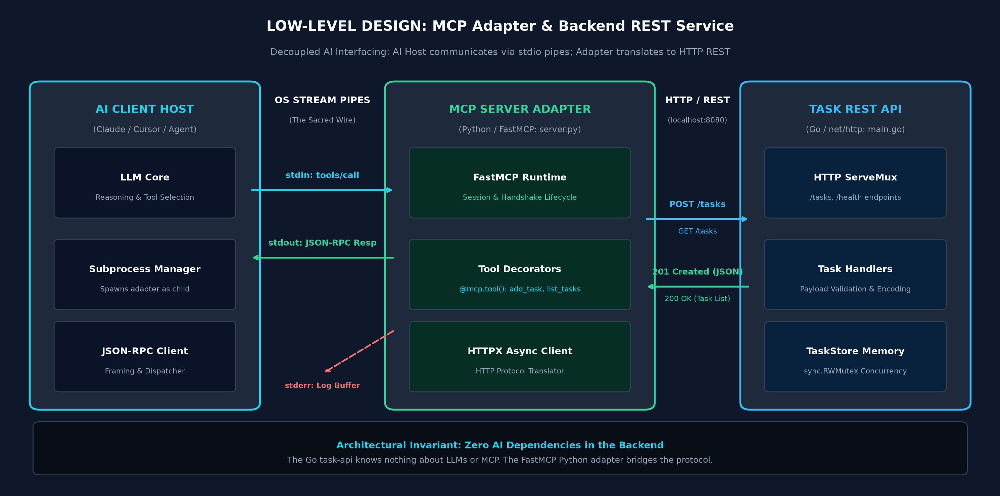

# Part 1 Reference Code: The First Handshake

This directory contains the complete, runnable source code accompanying **[Model Context Protocol (MCP) Explained, Part 1: The First Handshake](https://blogs.ashokmurugan.com/mcp-part-1-the-first-handshake)**.

---

## Low-Level Design (LLD) Architecture

The implementation demonstrates a production-grade, two-tier architecture:
1. **Business Domain Service (`task-api/`)**: A standard Go HTTP REST API exposing `/tasks` and `/health`. It has **zero awareness** of AI models or MCP.
2. **MCP Server Adapter (`server.py`)**: A Python FastMCP process that speaks JSON-RPC over OS `stdio` to the AI client and translates tool invocations into HTTP requests against the backend.

<p align="center">
  
</p>

---

## Directory Structure

```text
assets/
├── task-api/                  # Tier 1: Real-world Backend REST API (Go)
│   ├── go.mod                 # Go module definition
│   └── main.go                # HTTP REST server (:8080) with in-memory concurrent store
├── server.py                  # Tier 2: FastMCP Python Adapter (stdio transport)
├── requirements.txt           # Python dependencies (mcp, httpx)
├── lld-architecture.png       # Architecture diagram
└── README.md                  # This file
```

---

## How to Run Step-by-Step

### Prerequisites
* [Go 1.22+](https://go.dev/dl/) installed
* [Python 3.10+](https://www.python.org/downloads/) installed
* [Node.js 18+](https://nodejs.org/) (for the MCP Inspector)

---

### Step 1: Start the Task API Backend (Go)

The backend microservice manages task state concurrently using `sync.RWMutex`:

```bash
cd task-api
go run main.go
```
*Output:*
```text
2026/11/10 19:00:00 Starting Task REST API on http://localhost:8080 ...
```

You can verify the backend is live in another terminal:
```bash
curl http://localhost:8080/health
# Response: {"status":"ok"}

curl -X POST http://localhost:8080/tasks -H "Content-Type: application/json" -d '{"title":"Ship MCP Blog"}'
# Response: {"id":1,"title":"Ship MCP Blog","status":"PENDING","created_at":"..."}
```

---

### Step 2: Install Python Adapter Dependencies

From the `assets/` directory, install the required packages:

```bash
pip install -r requirements.txt
```

---

### Step 3: Test with the Official MCP Inspector

The [MCP Inspector](https://modelcontextprotocol.io/docs/tools/inspector) is the official developer tool provided by Model Context Protocol to test servers in an interactive browser UI without configuring an IDE:

```bash
npx @modelcontextprotocol/inspector python server.py
```

1. Open your browser to the URL displayed (typically `http://localhost:5173`).
2. Click **Connect** (uses `stdio` transport).
3. Switch to the **Tools** tab:
   - Click **List Tools**: Notice `add_task` and `list_tasks` automatically discovered.
   - Run `add_task` with `{"title": "Review PR #42"}`.
   - Run `list_tasks` with `{"status": "ALL"}`.
4. Check the backend Go terminal: observe the incoming HTTP requests routed cleanly through the adapter!

---

### Step 4: Configure in Claude Desktop or Cursor

To connect this adapter to **Claude Desktop**, add the following to your `claude_desktop_config.json`:

```json
{
  "mcpServers": {
    "task-manager": {
      "command": "python",
      "args": ["/ABSOLUTE/PATH/TO/assets/server.py"],
      "env": {
        "TASK_API_BASE": "http://localhost:8080"
      }
    }
  }
}
```

---

## Code Evolution Across the Series

This repository tracks the step-by-step evolution of an enterprise MCP implementation:

| Blog Part | Topic | Code Additions in Assets |
| :--- | :--- | :--- |
| **Part 1 (Current)** | **The First Handshake** | `task-api/` (Go REST API), `server.py` (FastMCP stdio adapter) |
| **Part 2 (Next)** | **Hands, Eyes, & Recipes** | Adding Resources (`tasks://all`) & Prompts (`daily_standup`) |
| **Part 3** | **Walkie-Talkies vs Radio** | Remote SSE Transport adapter (`sse_server.py`) on port `:8081` |
| **Part 4** | **Thinking & Doing** | Autonomous Agent Client host (`agent_chat.py`) with ReAct loop |
| **Part 5** | **The Big Red Button** | Security gatekeeper with Human-in-the-Loop confirmations & audit logs |
