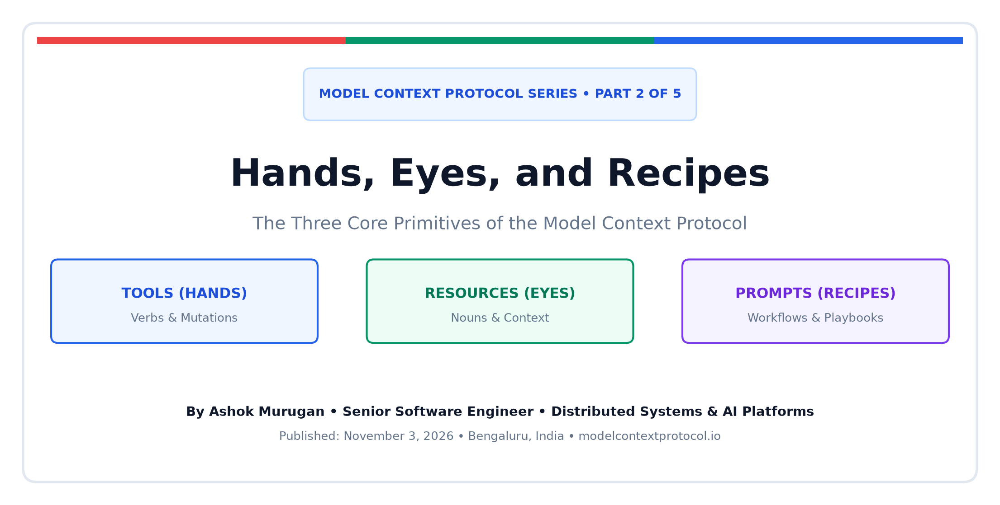
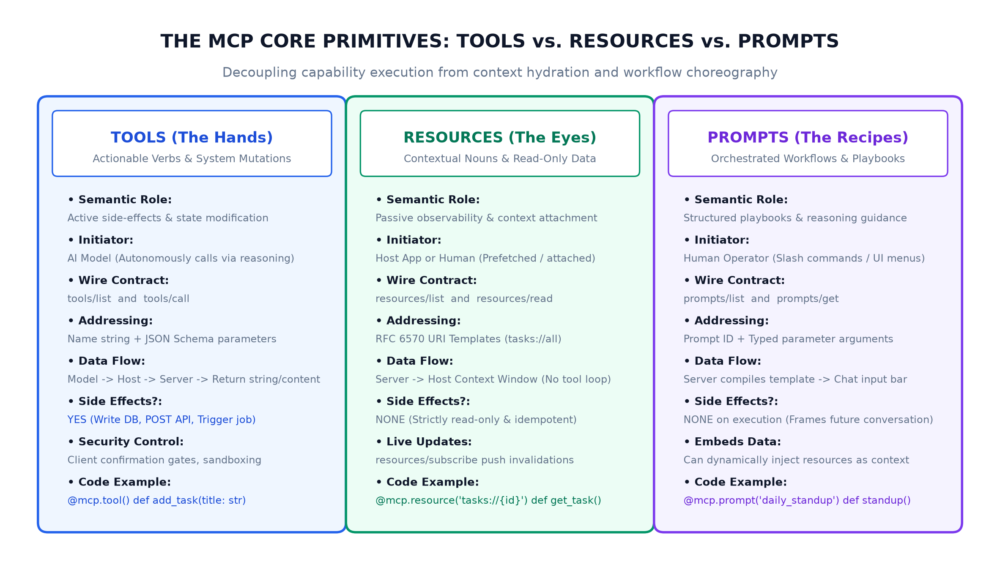
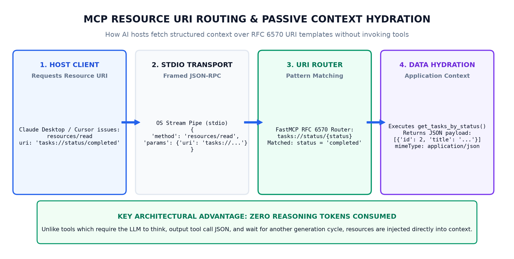
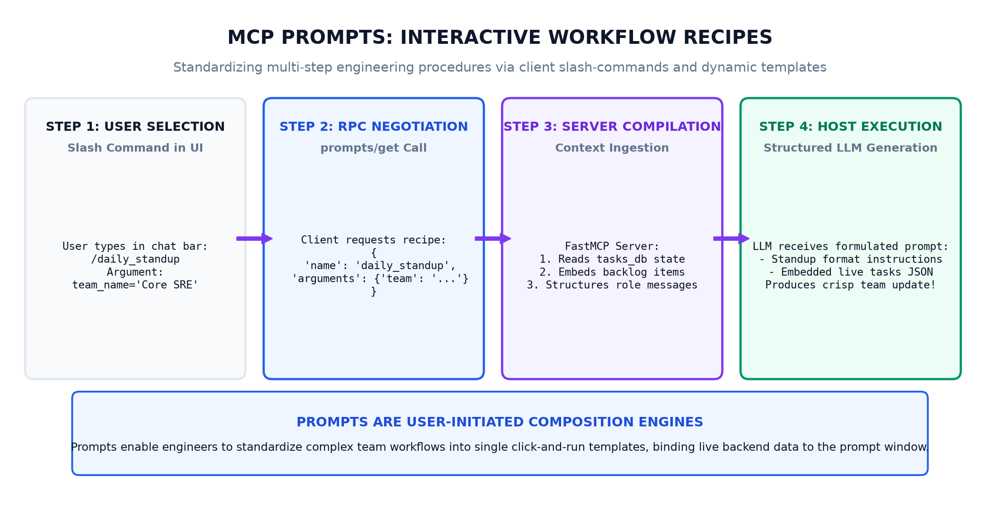

In [Part 1 of this series](https://blogs.ashokmurugan.com/mcp-part-1-the-first-handshake), we established the foundation of the [Model Context Protocol (MCP)](https://modelcontextprotocol.io/): how an AI host spawns an MCP server as a subprocess, negotiates capabilities during the initial `initialize` handshake over OS standard I/O pipes, and honors the golden rule of production stdio transports—**stdout is strictly sacred**.

Once that initial handshake completes, what actually travels across the wire? 

Most developers entering the MCP ecosystem assume it is merely an open-source clone of OpenAI function calling. That assumption misses the fundamental elegance of the protocol. MCP does not simply provide a mechanism to execute functions; it establishes a **three-pillar semantic architecture** that cleanly separates *what an AI can do*, *what an AI can see*, and *how a human guides the workflow*.

In MCP terminology, these three pillars are **Tools**, **Resources**, and **Prompts**—or as we architecturally categorize them: **Hands**, **Eyes**, and **Recipes**.

Understanding the crisp boundaries between these three primitives is the difference between building brittle, token-hungry AI wrappers and engineering high-throughput, enterprise-grade agent platforms.

---

## The Core MCP Triad

Every capability exposed by an MCP server to an AI model falls into one of three distinct primitives:



1. **Tools (The Hands)**: Executable verbs with active side effects. Tools represent actions that modify state, interact with external REST APIs, mutate database tables, or execute terminal commands. Tools are **model-controlled**—the LLM autonomously decides whether, when, and with what arguments to call them based on reasoning.
2. **Resources (The Eyes)**: Contextual nouns and read-only data streams. Resources represent static documents, database schemas, dynamic log tails, or application state. Resources are **host- or user-controlled**—they hydrate the model's context window passively without consuming reasoning cycles or risking unintended mutations.
3. **Prompts (The Recipes)**: Reusable, user-initiated workflow playbooks. Prompts parameterize complex tasks (such as code reviews, daily standup summaries, or incident triage) and surface directly in client interfaces like Claude Desktop or Cursor as slash commands.

Let us dissect each primitive in depth, examine its wire contract, and understand when to choose one over the other.

---

## 1. Tools (The Hands): Verbs & State Mutations

Tools are the most familiar primitive to developers with function calling experience. They give AI models the ability to act upon the world.

### Architectural Invariants of Tools
- **Model-Controlled Execution**: The AI client passes the list of tools to the LLM. The LLM determines if a tool call is required to satisfy the user's intent.
- **Active Side Effects**: Tools are explicitly designed for operations that change external state—inserting a row into PostgreSQL, creating a Jira ticket, posting a Slack message, or triggering a CI/CD build.
- **Strict Parameter Validation**: Every tool advertises its contract using standard JSON Schema. The host runtime validates the LLM's suggested arguments against this schema before dispatching the call over the wire.
- **Human-in-the-Loop Approvals**: Because tools introduce mutations, production MCP hosts (like Claude Desktop) inject client-side confirmation dialogs before executing sensitive tools.

### The Wire Contract: `tools/list` and `tools/call`

During the initialization phase or upon dynamic refresh, the client discovers available tools via `tools/list`:

```json
{
  "jsonrpc": "2.0",
  "id": 10,
  "method": "tools/list",
  "params": {}
}
```

The server responds with an array of tool descriptors, complete with JSON Schema validation metadata:

```json
{
  "jsonrpc": "2.0",
  "id": 10,
  "result": {
    "tools": [
      {
        "name": "add_task",
        "description": "Add a new engineering task to the system backlog.",
        "inputSchema": {
          "type": "object",
          "properties": {
            "title": { "type": "string", "description": "Concise task title" },
            "priority": { 
              "type": "string", 
              "enum": ["low", "medium", "high", "critical"],
              "default": "medium" 
            }
          },
          "required": ["title"]
        }
      }
    ]
  }
}
```

When the LLM decides to trigger this tool, the host dispatches `tools/call`:

```json
{
  "jsonrpc": "2.0",
  "id": 11,
  "method": "tools/call",
  "params": {
    "name": "add_task",
    "arguments": {
      "title": "Migrate Redis session store to cluster mode",
      "priority": "high"
    }
  }
}
```

The server executes the logic against the underlying backend service and returns a structured content payload:

```json
{
  "jsonrpc": "2.0",
  "id": 11,
  "result": {
    "content": [
      {
        "type": "text",
        "text": "Task #4 successfully created: 'Migrate Redis session store to cluster mode' [priority: high]."
      }
    ],
    "isError": false
  }
}
```

---

## 2. Resources (The Eyes): Nouns & Context Hydration

If Tools are an agent's hands, **Resources are its eyes**. 

A critical anti-pattern in early agent architectures was wrapping every data fetch in a tool (e.g., `get_system_metrics()`, `read_file()`, `fetch_user_profile()`). This approach has major drawbacks:
1. **Wasted Reasoning Tokens**: The LLM must spend a generation cycle evaluating whether to call the tool, formatting the JSON call arguments, and waiting for the roundtrip before generating an actual response.
2. **Non-Deterministic Hydration**: The model might hallucinate parameters or neglect to call the fetch tool altogether.
3. **Missing Host Integration**: The human operator has no visibility into what context is attached to their conversation until after the model decides to query it.

[MCP Resources](https://modelcontextprotocol.io/docs/concepts/resources) solve this by treating data as addressable, read-only URIs following [RFC 6570 URI Templates](https://datatracker.ietf.org/doc/html/rfc6570).



### Key Architectural Invariants of Resources
- **Host- or User-Controlled**: Resources can be attached directly by the user in the UI (e.g., typing `@tasks://all` or selecting a file attachment) or preloaded by the host application before the LLM prompt is assembled.
- **Strictly Read-Only & Idempotent**: A resource read must never trigger state mutations or side effects.
- **URI-Addressed**: Every resource is identified by a unique URI scheme, such as `tasks://all`, `postgres://cluster-1/schema`, or `file:///var/log/syslog`.
- **Dynamic URI Templates**: Servers can register dynamic parameter patterns (e.g., `tasks://status/{status}`) allowing hosts to query parameterized views cleanly.
- **Real-Time Subscriptions**: MCP clients can subscribe to resources using `resources/subscribe`. When the underlying data changes, the server pushes a `notifications/resources/updated` notification, enabling real-time context streaming.

### The Wire Contract: `resources/list` and `resources/read`

Discovery occurs via `resources/list`:

```json
{
  "jsonrpc": "2.0",
  "id": 20,
  "method": "resources/list",
  "params": {}
}
```

The server returns its registered static resources and dynamic URI templates:

```json
{
  "jsonrpc": "2.0",
  "id": 20,
  "result": {
    "resources": [
      {
        "uri": "tasks://all",
        "name": "All Engineering Tasks",
        "description": "Read-only ledger of active backlog tasks",
        "mimeType": "application/json"
      },
      {
        "uri": "tasks://stats",
        "name": "Task Completion Statistics",
        "description": "Aggregate backlog velocity and completion metrics",
        "mimeType": "application/json"
      }
    ]
  }
}
```

When the client requests data, it issues `resources/read`:

```json
{
  "jsonrpc": "2.0",
  "id": 21,
  "method": "resources/read",
  "params": {
    "uri": "tasks://status/completed"
  }
}
```

The server routes the request via its URI template pattern matcher, extracts `status = "completed"`, and returns the hydrated contents:

```json
{
  "jsonrpc": "2.0",
  "id": 21,
  "result": {
    "contents": [
      {
        "uri": "tasks://status/completed",
        "mimeType": "application/json",
        "text": "[\n  {\n    \"id\": 2,\n    \"title\": \"Implement Redis read-replica connection pool\",\n    \"status\": \"completed\"\n  }\n]"
      }
    ]
  }
}
```

Notice that **zero LLM reasoning tokens** were spent deciding whether to call a function. The host simply hydrated the model's prompt window with structured JSON before the model began its response.

---

## 3. Prompts (The Recipes): Workflows & Playbooks

The third primitive is often the most misunderstood: **Prompts**.

In MCP, a prompt is not just a hardcoded string. A Prompt is an **interactive, server-defined workflow template**. It allows MCP servers to expose pre-engineered standard operating procedures (SOPs) that users can invoke with a single slash command or menu selection.



### Key Architectural Invariants of Prompts
- **User-Initiated Orchestration**: Prompts surface in the host UI (e.g., typing `/daily_standup` in Claude Desktop). The human triggers them explicitly.
- **Dynamic Context Binding**: Prompts can dynamically pull live server state or resources (e.g., embedding `tasks://all`) into the generated prompt instructions before handing the combined prompt to the LLM.
- **Parameterized Arguments**: Prompts can declare required or optional arguments (e.g., `team_name`, `date_range`, `severity`). The host prompts the user to supply these parameters via interactive UI form fields.
- **Multi-Turn Role Formatting**: Prompts can return complex multi-turn message histories containing alternating `user` and `assistant` turns, pre-conditioning the model for structured reasoning.

### The Wire Contract: `prompts/list` and `prompts/get`

Discovery via `prompts/list`:

```json
{
  "jsonrpc": "2.0",
  "id": 30,
  "method": "prompts/list",
  "params": {}
}
```

The server advertises its workflow templates:

```json
{
  "jsonrpc": "2.0",
  "id": 30,
  "result": {
    "prompts": [
      {
        "name": "daily_standup",
        "description": "Construct an automated engineering daily standup summary workflow.",
        "arguments": [
          {
            "name": "team_name",
            "description": "Name of the engineering squad",
            "required": false
          }
        ]
      }
    ]
  }
}
```

When the user selects `/daily_standup` in their client UI, the client dispatches `prompts/get`:

```json
{
  "jsonrpc": "2.0",
  "id": 31,
  "method": "prompts/get",
  "params": {
    "name": "daily_standup",
    "arguments": {
      "team_name": "Core SRE & Infrastructure"
    }
  }
}
```

The server compiles the template, dynamically reads the latest task state from memory or database, and returns a fully formulated message array:

```json
{
  "jsonrpc": "2.0",
  "id": 31,
  "result": {
    "description": "Daily standup report for Core SRE & Infrastructure",
    "messages": [
      {
        "role": "user",
        "content": {
          "type": "text",
          "text": "You are the Staff Technical Lead for the 'Core SRE & Infrastructure' engineering squad...\n\n[Active Task Ledger Data]\n\nPlease generate a high-signal Daily Standup Report..."
        }
      }
    ]
  }
}
```

---

## Architectural Decision Matrix: When to Use What

When designing your enterprise MCP servers, use this rubric to determine whether a capability should be exposed as a **Tool**, a **Resource**, or a **Prompt**:

| Criterion | Tool (Hands) | Resource (Eyes) | Prompt (Recipes) |
| :--- | :--- | :--- | :--- |
| **Primary Semantic** | Action, verb, state mutation | Data, noun, context view | Procedure, playbook, template |
| **Who Initiates?** | Autonomous AI Model | Human user or Host App | Human user (Slash command) |
| **Causes Side Effects?** | **Yes** (Writes to DB, triggers APIs) | **No** (Strictly read-only) | **No** (Directly generates prompt text) |
| **Addressing Method** | Name string (`add_task`) | RFC 6570 URI (`tasks://all`) | Name string (`daily_standup`) |
| **Token Overhead** | Medium to High (Model reasoning roundtrip) | Low (Zero reasoning tokens spent querying) | Zero query overhead (Structures input context) |
| **User Confirmation** | Recommended for sensitive actions | Never required | Never required |
| **Live Subscriptions** | No | **Yes** (`resources/subscribe`) | No |

---

## Production Implementation: Building a Unified FastMCP Server

Let us construct a production-ready Python MCP server using the official [Python FastMCP SDK](https://github.com/modelcontextprotocol/python-sdk) that brings Tools, Resources, and Prompts together into a cohesive architecture.

### The Server Code: `server.py`

The complete, runnable reference implementation is maintained directly in this article's [GitHub Assets Directory](https://github.com/ashok-murugan/ashok-murugan-blogs/tree/main/mcp-part-2-hands-eyes-and-recipes/assets/server.py):

```python
"""
Model Context Protocol (MCP) Explained - Part 2 Reference Server
Demonstrating the Core MCP Triad: Tools (Hands), Resources (Eyes), and Prompts (Recipes).
"""

from datetime import datetime, timezone
import json
from typing import Any, Dict, List
from mcp.server.fastmcp import FastMCP

# Initialize FastMCP Server Instance
mcp = FastMCP("TaskMaster-Part2", dependencies=["mcp[cli]"])

# In-Memory Backend Data Ledger
tasks_db: List[Dict[str, Any]] = [
    {
        "id": 1,
        "title": "Migrate auth service to OAuth2 / OIDC",
        "description": "Deprecate legacy session tokens in favor of short-lived JWTs.",
        "status": "in-progress",
        "priority": "high",
        "created_at": "2026-11-01T10:00:00Z",
    },
    {
        "id": 2,
        "title": "Implement Redis read-replica connection pool",
        "description": "Offload cache read spikes from primary Redis node during peak traffic.",
        "status": "completed",
        "priority": "high",
        "created_at": "2026-11-01T14:30:00Z",
    },
    {
        "id": 3,
        "title": "Configure OpenTelemetry trace exporter for gRPC gateway",
        "description": "Propagate traceparent headers across external microservice boundaries.",
        "status": "pending",
        "priority": "medium",
        "created_at": "2026-11-02T09:15:00Z",
    },
]
next_id = 4


# ==============================================================================
# 1. RESOURCES (Eyes / Nouns / Read-Only Context)
# ==============================================================================

@mcp.resource("tasks://all", mime_type="application/json")
def get_all_tasks() -> str:
    """Read-only resource exposing the entire active task ledger."""
    return json.dumps(tasks_db, indent=2)


@mcp.resource("tasks://status/{status}", mime_type="application/json")
def get_tasks_by_status(status: str) -> str:
    """Dynamic URI template resource filtering tasks by status ('pending', 'in-progress', 'completed')."""
    normalized = status.lower().strip()
    filtered = [t for t in tasks_db if t["status"].lower() == normalized]
    return json.dumps(filtered, indent=2)


@mcp.resource("tasks://stats", mime_type="application/json")
def get_task_statistics() -> str:
    """Read-only aggregate metrics for current backlog health."""
    total = len(tasks_db)
    completed = sum(1 for t in tasks_db if t["status"] == "completed")
    in_progress = sum(1 for t in tasks_db if t["status"] == "in-progress")
    pending = sum(1 for t in tasks_db if t["status"] == "pending")
    rate = round((completed / total * 100), 1) if total > 0 else 0.0

    stats = {
        "total_tasks": total,
        "completed": completed,
        "in_progress": in_progress,
        "pending": pending,
        "completion_rate_percent": rate,
        "generated_at": datetime.now(timezone.utc).isoformat(),
    }
    return json.dumps(stats, indent=2)


# ==============================================================================
# 2. TOOLS (Hands / Verbs / Executable Mutations)
# ==============================================================================

@mcp.tool()
def add_task(title: str, description: str = "", priority: str = "medium") -> str:
    """Add a new engineering task to the system backlog.
    
    Args:
        title: Concise title of the task
        description: Technical details, acceptance criteria, or context
        priority: Urgency level ('low', 'medium', 'high', 'critical')
    """
    global next_id
    if not title.strip():
        return "Error: Task title cannot be empty."

    valid_priorities = {"low", "medium", "high", "critical"}
    prio = priority.lower().strip()
    if prio not in valid_priorities:
        prio = "medium"

    new_task = {
        "id": next_id,
        "title": title.strip(),
        "description": description.strip(),
        "status": "pending",
        "priority": prio,
        "created_at": datetime.now(timezone.utc).isoformat(),
    }
    tasks_db.append(new_task)
    assigned_id = next_id
    next_id += 1

    return f"Task #{assigned_id} successfully created: '{new_task['title']}' [priority: {prio}]."


@mcp.tool()
def complete_task(task_id: int) -> str:
    """Mark an existing task as completed.
    
    Args:
        task_id: Numeric unique identifier of the task
    """
    for task in tasks_db:
        if task["id"] == task_id:
            if task["status"] == "completed":
                return f"Task #{task_id} ('{task['title']}') was already completed."
            task["status"] = "completed"
            task["completed_at"] = datetime.now(timezone.utc).isoformat()
            return f"Success: Task #{task_id} ('{task['title']}') is now marked completed."
    return f"Error: Task with ID #{task_id} not found."


# ==============================================================================
# 3. PROMPTS (Recipes / Workflows / Playbooks)
# ==============================================================================

@mcp.prompt("daily_standup")
def daily_standup_prompt(team_name: str = "Core Infrastructure") -> str:
    """Construct an automated engineering daily standup summary workflow."""
    current_context = json.dumps(tasks_db, indent=2)
    return f"""You are the Staff Technical Lead for the '{team_name}' engineering squad.
Analyze the following active task ledger from our MCP task server:

{current_context}

Please generate a high-signal, executive-ready Daily Standup Report formatted as follows:
1. Completed Items (What was shipped and validated)
2. In-Flight Focus (What is actively under development today)
3. Roadblocks & Dependencies (Pending items requiring architectural unblocking)
4. Backlog Velocity Assessment (One sentence on current momentum)

Keep explanations technical, concise, and focused on systemic throughput."""


if __name__ == "__main__":
    mcp.run()
```

---

## Interactive Testing with the MCP Inspector

The fastest, cleanest way to test all three primitives in real time without configuring desktop clients is using the official **MCP Inspector** tool provided by the Model Context Protocol core team.

You can launch the Inspector with zero installation using `npx`:

```bash
# Clone the companion repository assets
git clone https://github.com/ashok-murugan/ashok-murugan-blogs.git
cd ashok-murugan-blogs/mcp-part-2-hands-eyes-and-recipes/assets

# Launch the interactive MCP Inspector UI
npx @modelcontextprotocol/inspector uv run server.py
```

The Inspector connects to the FastMCP server over standard OS pipes and opens a browser-based developer dashboard:

1. **Resources Inspection**:
   - Navigate to the **Resources** tab and click **List Resources**. You will see `tasks://all` and `tasks://stats`.
   - Click `tasks://all`. The inspector issues a `resources/read` JSON-RPC call and instantly renders the active JSON array.
   - Enter `tasks://status/in-progress` to test dynamic template routing.
2. **Tools Execution**:
   - Switch to the **Tools** tab. Observe how FastMCP translated Python type annotations and docstrings into a validated JSON Schema.
   - Execute `add_task` with `{"title": "Implement circuit breaker on payment gateway"}`.
   - Re-visit the **Resources** tab and read `tasks://all` again—the newly created task is immediately reflected in the state!
3. **Prompts Execution**:
   - Switch to the **Prompts** tab and select `daily_standup`.
   - Enter your team name (e.g., `Distributed Systems Team`).
   - Notice how the server formats the prompt, embeds the current live task ledger into the prompt instructions, and outputs a complete prompt ready for LLM inference.

A dedicated guide with step-by-step verification commands is included in the [Assets README](https://github.com/ashok-murugan/ashok-murugan-blogs/tree/main/mcp-part-2-hands-eyes-and-recipes/assets/README.md).

---

## Architectural Takeaways

As distributed systems engineers and AI platform builders, separating **Tools**, **Resources**, and **Prompts** unlocks three massive engineering benefits:

1. **Token Efficiency**: Resources provide passive context hydration without wasting LLM output tokens or reasoning latency on roundtrip tool selection.
2. **Deterministic Governance**: Workflows that require organizational compliance (such as daily standups, incident triage, and PR reviews) are encapsulated in standardized Prompts, eliminating reliance on random user prompting habits.
3. **Operational Safety**: By reserving Tools strictly for state mutations and coupling them with host confirmation gates, you protect production infrastructure against unintended agent actions.

In **[Part 3 of this series](https://blogs.ashokmurugan.com/mcp-part-3-under-the-hood-json-rpc-and-stdio-transport)**, we will peel back the abstraction layers and dive deep into the wire level: **JSON-RPC 2.0 framing, newline-delimited streaming, bidirectional notification flows, and managing OS subprocess lifecycles in high-concurrency environments**.
