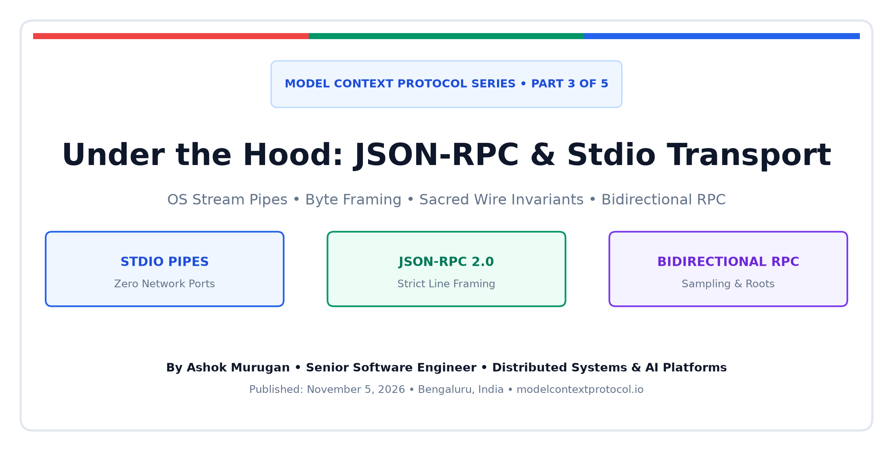
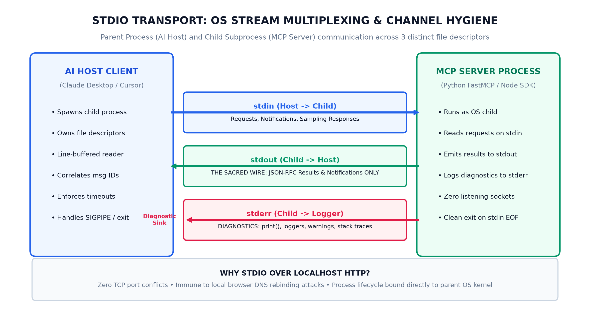
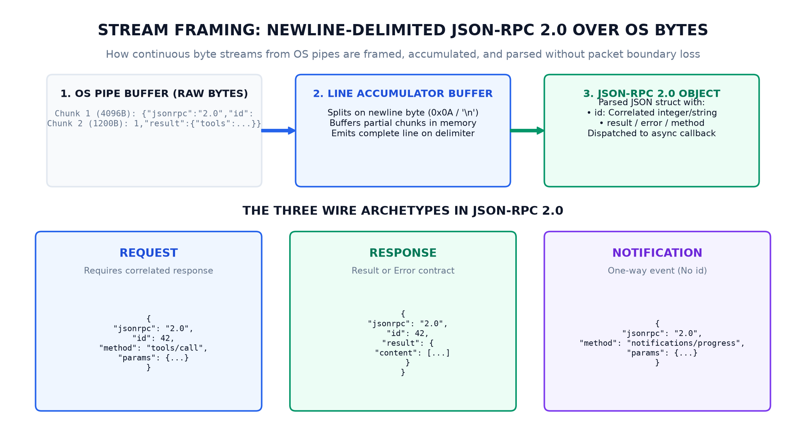
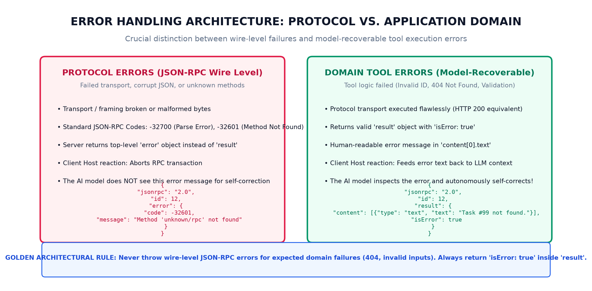

In [Part 1 of this series](https://blogs.ashokmurugan.com/mcp-part-1-the-first-handshake), we examined the initial capability handshake. In [Part 2](https://blogs.ashokmurugan.com/mcp-part-2-hands-eyes-and-recipes), we explored the core semantic primitives: **Tools** (Hands / Mutations), **Resources** (Eyes / Context), and **Prompts** (Recipes / Workflows).

High-level SDKs like [Python FastMCP](https://github.com/modelcontextprotocol/python-sdk) make writing MCP servers feel as effortless as decorating a Flask endpoint with `@mcp.tool()`. But when you take an AI agent platform into enterprise production, high-level abstractions eventually leak. 

What happens when a subprocess hangs silently? Why do certain debug `print()` statements cause an AI client to crash abruptly with an unhandled JSON parse error? How does an MCP server ask the AI host to perform a reasoning pass on its behalf?

To answer these questions, we must step underneath framework decorators and inspect the bare metal: **the OS stream transport, the JSON-RPC 2.0 framing rules, and the bidirectional communication contracts that govern the wire**.

---

## The Transport Decision: Why OS Stdio over Localhost HTTP?

When backend engineers first encounter MCP, their immediate instinct is often: *Why not just expose a REST API on localhost or connect over WebSockets?*

Standard POSIX / Windows stream pipes (`stdin` and `stdout`) were chosen as the primary default transport for three critical systems design reasons:



1. **Zero Port Collisions**: Local development environments frequently encounter `EADDRINUSE` port collision errors when multiple services fight over hardcoded TCP ports (such as `8080` or `3000`). With OS streams, the parent process spawns the child directly; no ports are allocated, bound, or scanned.
2. **Elimination of Localhost Security Vulnerabilities**: Running an unauthenticated HTTP or WebSocket server on `127.0.0.1` exposes a serious security boundary flaw. Any malicious website visited by a developer in their browser can issue cross-origin requests (`CORS` bypasses, DNS rebinding, or unauthorized `POST` commands) to target local services. Stdio pipes exist strictly inside the operating system process tree—**external network entities cannot touch them**.
3. **Deterministic Kernel Lifecycle Management**: If the parent host process (e.g., Claude Desktop or Cursor) crashes or is terminated by the user, the operating system kernel automatically closes the pipe file descriptors. The child subprocess receives an immediate `EOF` on its `stdin` stream or a `SIGPIPE` signal, allowing it to shut down cleanly without leaving orphaned zombie processes consuming system memory.

---

## The Three OS Stream Channels: Channel Hygiene

Every process launched by the operating system receives three default file descriptors: `0` (`stdin`), `1` (`stdout`), and `2` (`stderr`). In MCP stdio transport, maintaining strict channel discipline across these three streams is mandatory:

### Channel 1: `stdin` (Parent to Child)
- The AI host serializes JSON-RPC messages and writes them into the child's standard input pipe.
- The child process runs an asynchronous or threaded event loop reading lines continuously from `sys.stdin`.

### Channel 2: `stdout` (Child to Parent) — The Sacred Wire
- **This channel is strictly reserved for valid JSON-RPC payloads**.
- Every single byte written to `stdout` must belong to a valid, newline-delimited JSON-RPC object.
- A single rogue `print("Debugging DB connection...")` or third-party library banner dumped to `stdout` injects raw ASCII bytes into the protocol stream, causing the host's JSON parser to crash with a `JSONDecodeError`.

### Channel 3: `stderr` (Child to Diagnostic Sink)
- The diagnostic release valve. All application logging, debug statements, error traces, and telemetry must be routed to `stderr`.
- The AI host continuously drains `stderr` in a background thread, redirecting log lines to a local developer console or rolling log buffer without impacting the JSON-RPC parsing pipeline.

---

## Stream Framing: Newline-Delimited JSON-RPC 2.0

Operating system stream pipes are continuous streams of raw bytes; they do not possess innate message boundaries. If a client writes two messages in rapid succession, the server might read them together in a single OS buffer chunk. Conversely, if a server returns a large 100KB database schema, the payload may arrive fragmented across several consecutive `4096-byte` reads.

To solve this without complex length-prefix binary headers, the [MCP Specification](https://modelcontextprotocol.io/docs/concepts/transports) mandates a strict framing invariant:

> **All JSON-RPC messages on stdio transports must be serialized as single-line JSON strings terminated by a newline character (`\n` or `0x0A`).**



### The Accumulator Algorithm
Every production MCP host implements a stream accumulator:
1. It maintains an in-memory byte buffer for incoming stream chunks.
2. When a chunk arrives from the OS pipe, it appends the bytes to the accumulator.
3. It scans for the delimiter byte `\n`.
4. When `\n` is encountered, it extracts the preceding slice, deserializes it as a JSON-RPC object, dispatches it to an async worker, and trims the buffer.

Because newlines act as the message delimiter, raw JSON payloads emitted over the wire must **never contain unescaped raw newline characters**. Embedded newlines inside strings must be escaped as `\n`.

---

## The Three Wire Archetypes in JSON-RPC 2.0

Every message traveling across an MCP transport conforms to [JSON-RPC 2.0](https://www.jsonrpc.org/specification) and falls into one of three structural archetypes:

### 1. Request (Requires a Correlated Response)
Used when a sender expects an outcome. It must include a unique `id` (integer or string) and a `method` name:

```json
{
  "jsonrpc": "2.0",
  "id": 101,
  "method": "tools/call",
  "params": {
    "name": "query_database",
    "arguments": { "table": "users", "limit": 10 }
  }
}
```

### 2. Response (Result or Error)
Returned by the receiver to fulfill a pending request. It must echo the matching `id`:

```json
{
  "jsonrpc": "2.0",
  "id": 101,
  "result": {
    "content": [
      { "type": "text", "text": "Returned 10 records." }
    ],
    "isError": false
  }
}
```

### 3. Notification (One-Way Fire-and-Forget)
Used for event notifications, progress reporting, or stream updates. A notification **strictly omits the `id` field**. The receiver must never return a response:

```json
{
  "jsonrpc": "2.0",
  "method": "notifications/progress",
  "params": {
    "progressToken": "token-xyz",
    "progress": 75,
    "total": 100
  }
}
```

---

## Bidirectional RPC & Client Inversion

A common misconception is that the AI host is always the caller and the MCP server is always the responder. In reality, **MCP is fully bidirectional**. Once the handshake establishes session capabilities, the child subprocess can initiate requests back to the host client.

The two most powerful server-initiated capabilities are:

### 1. Sampling (`sampling/createMessage`)
An MCP server can ask the host AI to execute an LLM completion pass on its behalf!

For example, imagine a database analysis MCP server. After fetching 50 query plans, the server can issue a `sampling/createMessage` request back to Claude or Cursor, providing prompt messages and asking the host model to summarize performance bottlenecks. The server receives the model's generated text response and completes its business logic without needing its own independent OpenAI or Anthropic API key.

```json
{
  "jsonrpc": "2.0",
  "id": "server-req-1",
  "method": "sampling/createMessage",
  "params": {
    "messages": [
      {
        "role": "user",
        "content": {
          "type": "text",
          "text": "Analyze these SQL query execution plans for missing indices..."
        }
      }
    ],
    "maxTokens": 500
  }
}
```

### 2. Roots Discovery (`roots/list`)
An MCP server can query the client to discover what workspace directories or project boundaries the human currently has open in their IDE. This ensures file-system operations are bound strictly to active project roots.

---

## Error Handling Architecture: Protocol vs. Domain Errors

One of the most consequential architectural rules in MCP design is the strict separation between **wire-level protocol errors** and **model-recoverable domain errors**:



### Case A: Protocol Errors (Wire-Level JSON-RPC Failure)
Use standard JSON-RPC `error` objects only when the transport or protocol contract itself has broken:
- `code: -32700`: Parse Error (Malformation, non-JSON bytes).
- `code: -32600`: Invalid Request.
- `code: -32601`: Method Not Found (The client called an RPC method not exposed by the server).
- `code: -32602`: Invalid Params (Missing required arguments).

When a server returns a wire-level `error`, the host's RPC client throws an exception and halts execution. **The AI model never gets to see the error message to self-correct**.

### Case B: Domain Errors (Tool Execution Failures)
When an authorized tool executes but encounters an expected application-level problem (e.g., `Task #404 not found`, `Database connection timeout`, `Validation failed`), **never return a JSON-RPC wire error**.

Instead, return a successful JSON-RPC `result` object containing `"isError": true`:

```json
{
  "jsonrpc": "2.0",
  "id": 102,
  "result": {
    "content": [
      {
        "type": "text",
        "text": "Error: User with ID 'usr_982' does not exist in the tenant database."
      }
    ],
    "isError": true
  }
}
```

This simple distinction enables agentic autonomy: the host client detects `isError: true` and feeds the descriptive error string back to the LLM's conversation context. The model reads the feedback, understands what went wrong, and autonomously attempts an alternate query or informs the user gracefully!

---

## Zero-Dependency Implementation: Building a Pure Standard-Library Host & Server

To prove how lightweight MCP truly is, let us inspect a zero-dependency implementation written entirely using the standard Python runtime (`subprocess`, `threading`, `json`, `sys`).

The complete, runnable code is available in this article's [GitHub Assets Directory](https://github.com/ashok-murugan/ashok-murugan-blogs/tree/main/mcp-part-3-under-the-hood-json-rpc-and-stdio-transport/assets).

### 1. The Low-Level Host Client (`raw_mcp_client.py`)

Here is how an AI host spawns an MCP subprocess, multiplexes line-buffered standard streams, and enforces correlated RPC dispatching:

```python
import json
import subprocess
import sys
import threading
from typing import Any, Dict, Optional

class RawMCPClient:
    def __init__(self, command: list[str]):
        self.command = command
        self.process: Optional[subprocess.Popen] = None
        self._request_id = 0
        self._pending_requests: Dict[int, threading.Event] = {}
        self._responses: Dict[int, Dict[str, Any]] = {}

    def start(self):
        # Spawn child with line-buffered stream pipes
        self.process = subprocess.Popen(
            self.command,
            stdin=subprocess.PIPE,
            stdout=subprocess.PIPE,
            stderr=subprocess.PIPE,
            text=True,
            bufsize=1,  # Line-buffered
        )
        # Thread 1: Reader for stdout (The Sacred Wire)
        threading.Thread(target=self._read_stdout, daemon=True).start()
        # Thread 2: Reader for stderr (Diagnostic telemetry sink)
        threading.Thread(target=self._read_stderr, daemon=True).start()

    def _read_stdout(self):
        for line in self.process.stdout:
            line = line.strip()
            if not line:
                continue
            msg = json.loads(line)
            msg_id = msg.get("id")
            if msg_id is not None and msg_id in self._pending_requests:
                self._responses[msg_id] = msg
                self._pending_requests[msg_id].set()

    def _read_stderr(self):
        for line in self.process.stderr:
            sys.stderr.write(f"[Server Log] {line}")
            sys.stderr.flush()

    def send_request(self, method: str, params: Optional[Dict[str, Any]] = None, timeout: float = 5.0) -> Dict[str, Any]:
        self._request_id += 1
        req_id = self._request_id
        payload = {"jsonrpc": "2.0", "id": req_id, "method": method, "params": params or {}}
        
        # Newline-delimited framing
        wire_bytes = json.dumps(payload) + "\n"
        event = threading.Event()
        self._pending_requests[req_id] = event

        self.process.stdin.write(wire_bytes)
        self.process.stdin.flush()

        if not event.wait(timeout=timeout):
            raise TimeoutError(f"RPC #{req_id} timed out")

        del self._pending_requests[req_id]
        return self._responses.pop(req_id)

    def close(self):
        # Closing stdin triggers graceful child termination via EOF
        if self.process and self.process.stdin:
            self.process.stdin.close()
        if self.process:
            self.process.wait(timeout=3)
```

### 2. The Low-Level Server (`raw_stdio_server.py`)

And here is the child server responding over bare `sys.stdin` and `sys.stdout`:

```python
import json
import sys

def send_response(req_id: int, result: dict):
    payload = {"jsonrpc": "2.0", "id": req_id, "result": result}
    sys.stdout.write(json.dumps(payload) + "\n")
    sys.stdout.flush()

def main():
    sys.stderr.write("[Server] Listening on stdio...\n")
    sys.stderr.flush()

    for line in sys.stdin:
        line = line.strip()
        if not line:
            continue
        req = json.loads(line)
        method = req.get("method")
        req_id = req.get("id")

        if method == "initialize":
            send_response(req_id, {
                "protocolVersion": "2024-11-05",
                "capabilities": {"tools": {}},
                "serverInfo": {"name": "Pure-Stdio-Server", "version": "1.0"}
            })
        elif method == "tools/list":
            send_response(req_id, {
                "tools": [{
                    "name": "calculate_hash",
                    "description": "Compute deterministic string hash",
                    "inputSchema": {"type": "object", "properties": {"text": {"type": "string"}}}
                }]
            })
        elif method == "tools/call":
            text = req["params"]["arguments"]["text"]
            send_response(req_id, {
                "content": [{"type": "text", "text": f"Hash: {hash(text)}"}],
                "isError": False
            })

if __name__ == "__main__":
    main()
```

You can execute this test suite immediately:

```bash
# Clone and run the low-level transport test
git clone https://github.com/ashok-murugan/ashok-murugan-blogs.git
cd ashok-murugan-blogs/mcp-part-3-under-the-hood-json-rpc-and-stdio-transport/assets
python raw_mcp_client.py
```

---

## Architectural Takeaways

By understanding the systems fundamentals of the Model Context Protocol, we gain complete clarity over how modern agent platforms operate:

1. **Stdio is a deliberate engineering choice**: It guarantees process isolation, eliminates local port collisions, and protects developer workstations from unauthorized network requests.
2. **The stdout wire is inviolable**: Logging and tracing must strictly flow through `stderr`.
3. **Single-line newline framing is the law of the wire**: Streams must buffer until `\n` to prevent data corruption during OS pipe chunking.
4. **Tool domain failures belong in results**: Reserve wire-level JSON-RPC error codes for structural protocol breakdowns so the LLM has the opportunity to read the domain error and self-correct.

In **[Part 4 of this series](https://blogs.ashokmurugan.com/mcp-part-4-production-hardening-security-sandboxing-and-observability)**, we will turn our focus to production operations: **securing MCP adapters with OS sandboxing (Docker/Bubblewrap), enforcing token rate limits, and instrumenting distributed OpenTelemetry spans across the stdio boundary**.
