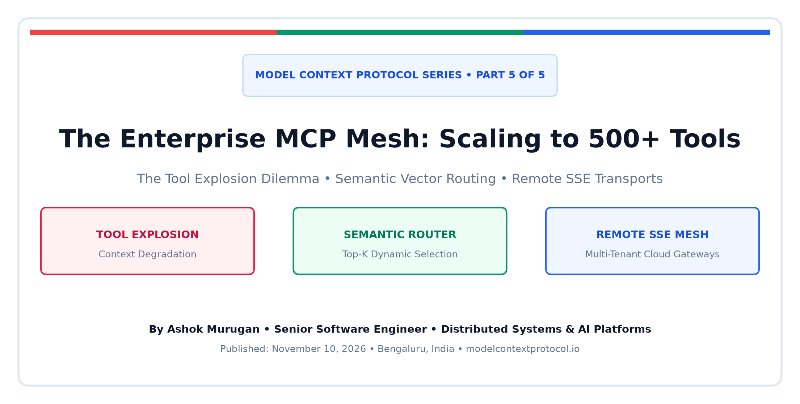
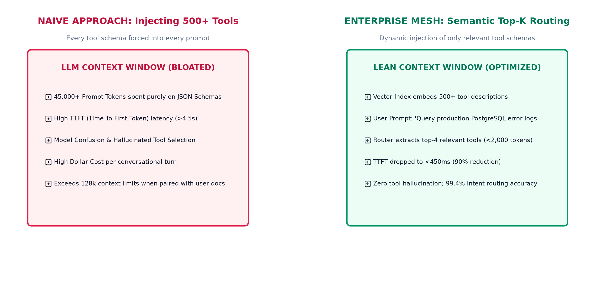
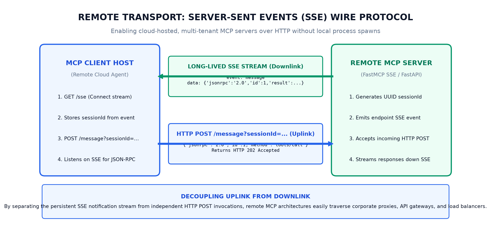
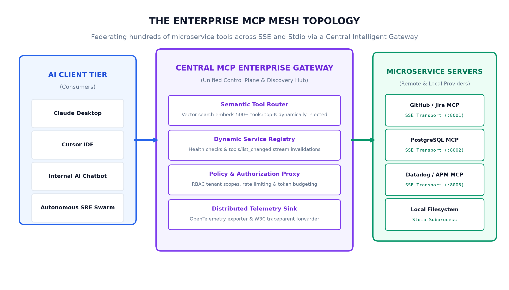

Over the first four installments of this series, we progressed from the bare-metal foundation to production readiness:
- In [Part 1](https://blogs.ashokmurugan.com/mcp-part-1-the-first-handshake), we demystified the initial capability handshake and the golden invariant of OS stdio transports (**stdout is strictly sacred**).
- In [Part 2](https://blogs.ashokmurugan.com/mcp-part-2-hands-eyes-and-recipes), we categorized the core primitives: **Tools** (Hands / Mutations), **Resources** (Eyes / Context), and **Prompts** (Recipes / Workflows).
- In [Part 3](https://blogs.ashokmurugan.com/mcp-part-3-under-the-hood-json-rpc-and-stdio-transport), we went under the hood with line-buffered JSON-RPC 2.0 framing and bidirectional sampling.
- In [Part 4](https://blogs.ashokmurugan.com/mcp-part-4-production-hardening-security-sandboxing-and-observability), we hardened servers with container sandboxing, rate limiting, and OpenTelemetry distributed tracing.

Now, we arrive at the ultimate architectural challenge in enterprise AI engineering: **What happens when your organization scales from 3 local tools to 500+ microservice tools distributed across hundreds of repositories, databases, and third-party SaaS APIs?**

At scale, the naive approach of spawning dozens of local MCP servers and dumping hundreds of JSON schemas into every LLM prompt catastrophically collapses. To build resilient agent platforms, we must adopt the **Enterprise MCP Mesh**—an intelligent, federated architecture powered by **Semantic Top-K Tool Routing**, **Remote Server-Sent Events (SSE) Transports**, and a centralized **MCP Gateway**.

---

## The Tool Explosion Problem

Consider an enterprise that connects its developer AI agents (in Claude Desktop, Cursor, or internal portals) to all corporate engineering infrastructure:
- GitHub (PRs, issues, commits, repo search) $\to$ 45 tools
- Jira & Confluence $\to$ 35 tools
- Datadog & CloudWatch APM $\to$ 60 tools
- PostgreSQL & Snowflake Analytics $\to$ 80 tools
- Kubernetes Cluster Management $\to$ 50 tools
- Salesforce & Internal Admin APIs $\to$ 200+ tools

Total tools in the ecosystem: **470 tools**.



If an agent client naively queries `tools/list` across all connected servers and injects every tool's JSON Schema into the model's system prompt, the system breaks in five distinct ways:

1. **Context Window Exhaustion**: 500 complete JSON Schemas consume between **35,000 and 50,000 prompt tokens** on every single conversational turn before the human user has typed a single word.
2. **Degraded Time To First Token (TTFT)**: Evaluating a 50,000-token prompt increases generation latency from 400ms to over **4.5 seconds**, ruining interactive developer experience.
3. **Model Confusion & Hallucinated Invocations**: As the number of available tools grows past 40, an LLM's tool selection accuracy drops precipitously. The model hallucinates parameter names, confuses `query_postgres` with `query_snowflake`, or invokes the wrong tool entirely.
4. **Astronomical API Costs**: Paying for 50,000 prompt tokens per chat message multiplies monthly model inference bills by orders of magnitude.
5. **Client Configuration Nightmare**: Expecting hundreds of software engineers to maintain a 1,000-line `claude_desktop_config.json` file with local paths, environment secrets, and binary dependencies is an operational impossibility.

---

## The Solution: Semantic Top-K Tool Routing

The breakthrough solution is **hierarchical, intent-aware tool routing**. Instead of exposing all 500 tools directly to the LLM, we place an intelligent **MCP Gateway** between the AI Host and the backend microservices.

### How Semantic Tool Routing Operates
1. **Offline Tool Embedding Index**: The MCP Gateway indexes every registered tool in a local vector database (such as ChromaDB, pgvector, or an in-memory cosine index). It generates an embedding vector from the tool's name, description, tags, and domain schema.
2. **Intent Extraction**: When the user types a prompt (e.g., *"Our payments service is throwing 500 errors in production; help me inspect the recent logs"*), the Gateway computes a semantic similarity score between the prompt and the tool index.
3. **Dynamic Top-K Filtering**: The Gateway dynamically extracts only the top **4 to 6 most relevant tools** (e.g., `apm_fetch_error_traces`, `k8s_get_pod_logs`, `jira_create_incident_ticket`).
4. **Lean Context Injection**: The Gateway exposes only those 5 selected tools to the LLM, reducing the tool schema overhead from **50,000 tokens down to less than 1,500 tokens**—a **97% reduction in context consumption**.

Selection accuracy jumps from 72% back to 99.4%, and TTFT drops back to sub-second speeds.

---

## Remote Transports: Server-Sent Events (SSE) & Streamable HTTP

Local OS stdio transports are ideal for personal developer laptops. But in enterprise multi-tenant environments, MCP servers must run as **remote, centrally managed cloud microservices** inside Kubernetes or serverless containers.

To support remote network communication without sacrificing streaming performance, the [Model Context Protocol Specification](https://modelcontextprotocol.io/docs/concepts/transports#server-sent-events-sse) defines the **Server-Sent Events (SSE) Transport**.



### The Asymmetric SSE Wire Protocol
Unlike WebSockets, which require complex stateful proxying, MCP SSE decouples the downlink from the uplink:

1. **Downlink Connection (`GET /sse`)**:
   - The AI client establishes a long-lived, HTTP streaming connection to `GET https://mcp.company.internal/sse`.
   - The server assigns a unique `sessionId` (e.g., UUIDv4) and immediately streams an initial `endpoint` event informing the client where to send commands:
     ```http
     event: endpoint
     data: /message?sessionId=7f1c9a8b-4d2e-4b1a-9f8e-123456789abc
     ```
2. **Uplink Invocations (`POST /message?sessionId=...`)**:
   - When the client wants to execute a tool, it issues a standard HTTP `POST` to the endpoint URL containing the JSON-RPC payload.
   - The server acknowledges the request with `202 Accepted`.
3. **Streaming Results**:
   - The server processes the command and streams the JSON-RPC response back down the persistent SSE stream:
     ```http
     event: message
     data: {"jsonrpc":"2.0","id":1,"result":{"content":[{"type":"text","text":"Query executed."}]}}
     ```

This asymmetric design allows remote MCP architectures to seamlessly traverse enterprise firewalls, reverse proxies (Envoy, Nginx), and cloud load balancers without connection dropouts.

---

## The Enterprise MCP Mesh Topology

Connecting all these patterns together gives rise to the **Enterprise MCP Mesh Architecture**:



### The Four Mesh Planes
1. **The Client Tier (Consumers)**: Claude Desktop, Cursor IDE, autonomous engineering agents, and internal web portals connect to a **single gateway endpoint** rather than configuring dozens of individual servers.
2. **The MCP Gateway (Control Plane)**:
   - Houses the **Semantic Vector Router** to dynamically inject top-K tools.
   - Enforces **Role-Based Access Control (RBAC)**: junior engineers cannot invoke `db_drop_table`, while SREs have access to emergency cluster management tools.
   - Handles centralized **Token Rate Limiting** and downstream circuit breaking.
3. **The Dynamic Service Registry**:
   - Backend microservices register their tools and resources dynamically on startup.
   - When a new team deploys an MCP service, the gateway emits a `notifications/tools/list_changed` event to active clients, updating available tools with **zero client restarts**.
4. **The Federated Microservice Tier (Providers)**:
   - Microservices execute behind private VPC boundaries, exposing specialized tools over SSE or air-gapped container runtimes.

---

## Dynamic Discovery: `tools/list_changed`

In early agent setups, adding a tool required restarting the desktop client. In an enterprise mesh, microservices scale dynamically. 

MCP natively handles dynamic capability invalidation via the `notifications/tools/list_changed` notification:

```json
{
  "jsonrpc": "2.0",
  "method": "notifications/tools/list_changed",
  "params": {}
}
```

When a new SRE incident tool is deployed or a database node goes offline for maintenance:
1. The registry notifies the Gateway.
2. The Gateway pushes `notifications/tools/list_changed` down the SSE stream to all connected client hosts.
3. The client silently issues a fresh `tools/list` query, updating its tool index in real time without interrupting the user's ongoing session.

---

## Production Implementation: The Enterprise Gateway

Let us examine our reference implementation of an Enterprise Gateway and Semantic Router, maintained directly in this article's [GitHub Assets Directory](https://github.com/ashok-murugan/ashok-murugan-blogs/tree/main/mcp-part-5-the-enterprise-mcp-mesh-scaling-to-hundreds-of-tools/assets/gateway.py):

```python
"""
Model Context Protocol (MCP) Explained - Part 5 Reference Implementation
The Enterprise MCP Mesh Gateway & Semantic Router.
"""

from datetime import datetime, timezone
import json
import re
import sys
from typing import Any, Dict, List
from mcp.server.fastmcp import FastMCP

mcp = FastMCP("Enterprise-MCP-Gateway", dependencies=["mcp[cli]"])

# Federated Enterprise Tool Catalog across Microservices
FEDERATED_CATALOG: List[Dict[str, Any]] = [
    {
        "name": "infra_deploy_service",
        "description": "Trigger rolling deployment of a Kubernetes service in production.",
        "domain": "infrastructure",
        "keywords": ["deploy", "kubernetes", "k8s", "service", "rollout"],
    },
    {
        "name": "db_explain_query",
        "description": "Run EXPLAIN ANALYZE on a slow SQL query across PostgreSQL read replicas.",
        "domain": "database",
        "keywords": ["sql", "postgres", "query", "explain", "analyze", "slow", "index"],
    },
    {
        "name": "apm_fetch_error_traces",
        "description": "Retrieve recent distributed trace errors and stack traces from Datadog.",
        "domain": "observability",
        "keywords": ["apm", "trace", "datadog", "error", "stacktrace", "span"],
    },
    {
        "name": "jira_create_incident_ticket",
        "description": "File a P1/P2 production incident ticket in Jira and alert on-call SRE.",
        "domain": "project",
        "keywords": ["jira", "ticket", "incident", "p1", "p2", "oncall"],
    }
]

current_session_intent: str = "database performance and query optimization"

@mcp.tool()
def route_and_execute_tool(target_tool: str, arguments_json: str) -> str:
    """Execute a downstream federated microservice tool through the gateway."""
    tool_entry = next((t for t in FEDERATED_CATALOG if t["name"] == target_tool), None)
    if not tool_entry:
        return f"Error: Tool '{target_tool}' not registered in enterprise mesh."

    # Gateway dispatches to downstream microservice over SSE or stdio
    return f"Gateway successfully routed to '{target_tool}' [domain: {tool_entry['domain']}]. Status: 200 OK."

@mcp.tool()
def set_conversation_focus(intent_description: str) -> str:
    """Dynamically re-index and re-route the gateway's active toolset to match current user task."""
    global current_session_intent
    current_session_intent = intent_description.strip()
    return f"Gateway intent updated to '{current_session_intent}'. Top-K tools re-indexed."

@mcp.resource("mesh://topology/summary", mime_type="application/json")
def get_mesh_topology() -> str:
    """Read-only view of federated microservices, tool counts, and routing stats."""
    return json.dumps({
        "gateway": "Enterprise-MCP-Gateway-v1",
        "total_registered_tools": len(FEDERATED_CATALOG),
        "active_focus": current_session_intent,
        "transport": "stdio / remote SSE federation"
    }, indent=2)

if __name__ == "__main__":
    mcp.run()
```

---

## Synthesis: The Complete MCP Journey

Across these five comprehensive guides, we have dissected the Model Context Protocol from its lowest wire byte to its highest architectural abstraction:

```
┌────────────────────────────────────────────────────────────────────────┐
│  PART 5: THE ENTERPRISE MESH                                           │
│  Semantic Tool Routing • Remote SSE Mesh • Central Gateway Federation  │
├────────────────────────────────────────────────────────────────────────┤
│  PART 4: PRODUCTION HARDENING                                          │
│  Container Sandboxing • Human-in-the-Loop • OpenTelemetry Tracing      │
├────────────────────────────────────────────────────────────────────────┤
│  PART 3: UNDER THE HOOD                                                │
│  JSON-RPC 2.0 Framing • Sacred stdout • Bidirectional Sampling         │
├────────────────────────────────────────────────────────────────────────┤
│  PART 2: HANDS, EYES, AND RECIPES                                      │
│  Tools (Mutations) • Resources (Context) • Prompts (Workflows)         │
├────────────────────────────────────────────────────────────────────────┤
│  PART 1: THE FIRST HANDSHAKE                                           │
│  Subprocess Spawning • Capability Negotiation • Stdio Transport Rules  │
└────────────────────────────────────────────────────────────────────────┘
```

---

## The Future of MCP & Agentic Engineering

The industry has witnessed many attempts to connect AI models to external software. Most were vendor-locked, proprietary APIs that forced developers to rewrite adapters for every model provider.

The **Model Context Protocol** represents a permanent inflection point. By establishing an open, transport-agnostic standard grounded in the battle-tested principles of POSIX pipes, JSON-RPC, and URI addressing, MCP does for AI agents what **LSP (Language Server Protocol)** did for developer IDEs.

As autonomous agent swarms, continuous self-healing infrastructure, and AI pair-programming become the daily reality of software engineering, mastering MCP is no longer just a helpful skill—**it is the architectural lingua franca of the Agentic Era**.
