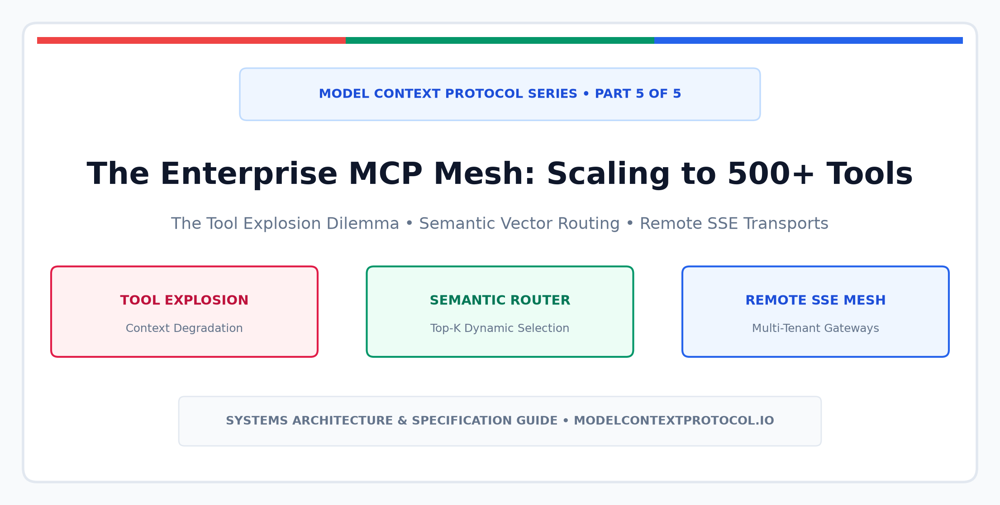

Over the first five installments of our comprehensive series on the [Model Context Protocol (MCP)](https://modelcontextprotocol.io/), we mapped the foundational architecture from bare metal to enterprise scale:
- [Part 1: The First Handshake](https://blogs.ashokmurugan.com/mcp-part-1-the-first-handshake) established the client-server capability negotiation over sacred OS `stdio` streams.
- [Part 2: Hands, Eyes, and Recipes](https://blogs.ashokmurugan.com/mcp-part-2-hands-eyes-and-recipes) dissected the core primitives: **Tools**, **Resources**, and **Prompts**.
- [Part 3: Under the Hood: JSON-RPC & Stdio Transport](https://blogs.ashokmurugan.com/mcp-part-3-under-the-hood-json-rpc-and-stdio-transport) analyzed framing, transport mechanics, and bidirectional sampling.
- [Part 4: Production Hardening: Security, Sandboxing & Observability](https://blogs.ashokmurugan.com/mcp-part-4-production-hardening-security-sandboxing-and-observability) built defense-in-depth rings, rate limiters, and distributed tracing.
- [Part 5: The Enterprise MCP Mesh: Scaling to Hundreds of Tools](https://blogs.ashokmurugan.com/mcp-part-5-the-enterprise-mcp-mesh-scaling-to-hundreds-of-tools) solved the tool-explosion problem with semantic top-k routing and SSE gateways.

> 💡 **The Foundational Curriculum Invariant**  
> **Parts 1 through 5** represent the complete, self-contained architectural foundation of the Model Context Protocol. If your goal is to master the protocol specification, build custom adapters, and deploy an enterprise mesh, you can stop at Part 5.  
>  
> Starting with **Part 6**, we enter our **Production Battle Scars & Improvisations** tier. These installments are dedicated to the messy, high-stakes operational traps encountered by engineering teams running autonomous AI agents under real production workloads.

---

## Introduction — The Illusion of the Happy Path

In developer documentation and tutorials, distributed tool calls are depicted as orderly, happy-path transactions:
1. The AI model emits an invocation: `{"name": "add_task", "arguments": {"title": "Deploy v2"}}`.
2. The MCP server executes the database query or dispatches a request to a sidecar microservice.
3. The server formats a JSON-RPC response: `{"content": [{"type": "text", "text": "Task #42 created"}]}`.
4. The agent reads the string, notes the successful state change, and continues reasoning.

In production, however, **distributed systems fail in uncoordinated, partial ways**.

### The Post That Sparked It All Emilio Ranucolis Field Report

Following the release of our 5-part guide, senior engineer **Emilio Ranucoli** ([@ranuk_dev on X](https://x.com/ranuk_dev/status/2121984868292702225?a=vTZJL0MgWYUNW8nJea4&s=20)) surfaced a critical edge case encountered in their agentic pipelines:

> *"The catch is that partial writes are a silent failure mode. In our pipelines we hit this when a tool call's sidecar process died mid-write, leaving the agent with a false success signal. The fix was adding a read-back verify to every mutating handler."*

Emilio's observation highlights a fatal blind spot in agent engineering: **The False Success Signal**. When an autonomous agent receives an unverified success acknowledgment for a half-committed or failed write, it corrupts the model's reasoning loop far more severely than a hard exception ever could.

---

## The Anatomy of a Silent Failure Mode

Why do partial writes happen in MCP ecosystems, and why are they silent?

### Why Sidecars and Subprocesses Die Mid-Write

Modern enterprise MCP servers rarely talk to monolithic local scripts; they orchestrate sidecar microservices, ephemeral Docker containers, and external APIs. These sidecars die unexpectedly:
1. **Linux OOM Killer:** A sidecar container exhausts its cgroup memory limit while serializing a large JSON payload and receives `SIGKILL` mid-write.
2. **Rolling Deployments & Pod Eviction:** A Kubernetes worker receives a `SIGTERM` while executing a multi-statement transaction, terminating before the `COMMIT` is recorded.
3. **Network Partition & Socket Severing:** An upstream HTTP/gRPC connection drops after headers have been acknowledged but before the payload is fully persisted.

### Why Transports Emit False Positives

When a sidecar or worker process dies mid-write, traditional web frameworks and reverse proxies (like Nginx, Envoy, or stdio wrappers) often exhibit lenient termination behavior:
* A reverse proxy or host adapter may have buffered an HTTP `200 OK` header early in the stream.
* An asynchronous event loop may catch a process `EOF` and fall back to returning whatever partial output was buffered in `stdout`.
* An MCP tool handler that follows a naive "fire-and-forget" pattern assumes that because its local network call didn't throw an immediate connection error, the remote storage layer successfully committed the data.

The tool handler returns a text block indicating success, and the JSON-RPC wire frames it as a valid `result`.

---

## Why AI Agents Make Partial Writes Catastrophic

In traditional microservices, a partial write typically breaks a downstream API call or fails an integration test, alerting human on-call engineers.

In an **Autonomous Agent System**, a partial write is catastrophic for two reasons:

### Context Windows as Absolute Ground Truth

An LLM has no physical perception of your storage clusters; **its context window is its entire reality**. 
* If a tool response reads `"Task #42 created"`, the model incorporates that assertion as an immutable fact into its working memory.
* Unlike a human developer who might query `psql` or check a dashboard if something feels off, an LLM possesses zero organic skepticism regarding tool return values.

### The Cascading Hallucination Loop

Once an unverified success signal enters the context window, subsequent decisions build upon that hallucinated ground truth:

```
[Agent] ──(add_task: "Provision cluster")──► [Tool / Sidecar]
                                                   │
                                            [Crashes Mid-Write]
                                                   │
[Agent] ◄──(False Success: "Cluster #42 Ready")────┘
   │
   ▼
[Agent Step 2]: "Cluster #42 is ready. Deleting legacy backup cluster #41..."
   │
   ▼
[Catastrophe]: Backup deleted, new cluster was never actually committed!
```

The agent executes dependent, destructive actions against an uncommitted phantom state.

---

## The Read-Back Verification Pattern

To make mutating tools resilient against sidecar deaths and silent failures, we enforce **The Read-Back Verification Pattern** across every tool that alters system state.

### The Write-Read-Assert Workflow

A production mutating handler must never emit a success response based solely on the return code of an outgoing write. Instead, it must follow a strict three-phase contract:

```
[Agent Invokes Mutating Tool]
             │
             ▼
   ┌───────────────────┐
   │ 1. EXECUTE WRITE  │ ──► Send mutation payload to storage/sidecar
   └───────────────────┘
             │
             ▼
   ┌───────────────────┐
   │ 2. READ-BACK      │ ──► Query the source of truth by unique ID
   └───────────────────┘
             │
             ▼
      {State Matches?}
       ├── No / Crash ──────► Return Explicit CRITICAL_ERROR (Fail Closed)
       └── Yes
             │
             ▼
   ┌───────────────────┐
   │ 3. RETURN SUCCESS │ ──► Return verified state proof to Agent context
   └───────────────────┘
```

1. **Phase 1: Write:** Dispatch the insert, update, or deletion.
2. **Phase 2: Read-Back:** Immediately fetch the newly mutated entity directly from the canonical persistence layer using its unique identifier.
3. **Phase 3: Assert:** Verify that the retrieved record exists, its status matches the expected post-mutation state, and its payload checksum aligns with what was requested.
4. **Phase 4: Respond:** Only when the assertion passes does the tool return a success payload containing verified proof (timestamps, version numbers, or entity hashes).

### Structuring Fail-Closed Error Taxonomy

If the read-back check fails, times out, or detects a state mismatch, the handler must **fail closed**:
* Return `isError: true` on the JSON-RPC wire.
* Clearly format the message so the LLM understands that the action did **not** commit:
  ```json
  {
    "isError": true,
    "content": [{
      "type": "text",
      "text": "CRITICAL_ERROR: Write verification failed for Task #42. Record not found in store. Partial write detected. Do not proceed with dependent actions."
    }]
  }
  ```

---

## Filesystem Atomicity and The Write-Temp-Rename Invariant

Mutations do not only occur in SQL databases; many MCP tools write configuration files, code diffs, or artifacts to local disk.

### The Trap of Truncated File Writes

A standard `with open(path, "w") as f: f.write(large_blob)` call is inherently unsafe:
* If the server process or container is terminated midway through the write, the file on disk is left truncated or corrupt.
* When the agent later reads that file, it consumes broken JSON or syntax errors, derailing downstream compilation steps.

### Atomic Swaps on POSIX and NTFS

To guarantee filesystem atomicity across process deaths, all file mutations must implement **Temp-and-Rename semantics**:

```python
import os
from pathlib import Path
import tempfile

def write_file_atomic(target_path: Path, content: str) -> int:
    """Atomically commit content to disk.
    Leaves either the previous file or the complete new file, never a partial write.
    """
    target_path.parent.mkdir(parents=True, exist_ok=True)
    
    # 1. Write to temporary file on the same filesystem
    with tempfile.NamedTemporaryFile("w", dir=target_path.parent, delete=False, encoding="utf-8") as f:
        temp_name = Path(f.name)
        f.write(content)
        f.flush()
        os.fsync(f.fileno())  # Force OS buffers to physical disk

    # 2. Atomic filesystem replace (POSIX rename / Windows MoveFileEx)
    os.replace(temp_name, target_path)

    # 3. Read-back verification
    actual_size = target_path.stat().st_size
    expected_size = len(content.encode("utf-8"))
    if actual_size != expected_size:
        raise IOError(f"Verification failed: expected {expected_size} bytes, found {actual_size}")
        
    return actual_size
```

Because `os.replace` is an atomic OS operation on both POSIX and Windows NTFS, a crash during the write phase leaves the original file completely untouched, preventing silent corruption.

---

## Idempotency Keys and Safe Retry Semantics

When an MCP client or agent encounters a transient network timeout or a suspected process crash, its natural instinct is to retry the call.

### Why Autonomous Agents Retry

When an LLM agent receives an ambiguous error (`"Connection reset by peer"` or `"Timeout waiting for tool response"`), ReAct loops often resubmit the tool call with identical arguments. Without safeguards, retrying a mutating handler produces **duplicate tasks, double-billed charges, or repeated deletions**.

### De-duplicating Agent Mutations

Production mutating tools must accept an optional **Idempotency Key**:
* The host agent generates a deterministic token for the action (e.g., `idempotency_key = sha256(agent_session_id + step_index)`).
* The MCP server checks if an entity with this idempotency key already exists.
* If a match is found, the server bypasses execution and immediately returns the verified existing record, enabling safe, transparent retries.

---

## Production Implementation verified_handler.py

Here is our production reference implementation incorporating Read-Back Verification, Filesystem Atomicity, and Idempotency Keys, available in full in this article's [GitHub Companion Directory](https://github.com/ashok-murugan/ashok-murugan-blogs/tree/main/mcp-part-6-production-battle-scars-partial-writes-and-fault-tolerance/assets/verified_handler.py):

```python
"""
Model Context Protocol (MCP) Explained - Part 6 Reference Implementation
Demonstrating Read-Back Verification, Filesystem Atomicity, and Idempotency.
"""

from datetime import datetime, timezone
import json
import os
from pathlib import Path
import sys
import tempfile
from typing import Any, Dict, Optional
from mcp.server.fastmcp import FastMCP

mcp = FastMCP("BattleHardenedServer-Part6", dependencies=["mcp[cli]"])

# Simulated Canonical Storage
tasks_db: Dict[int, Dict[str, Any]] = {}
next_id = 1

def audit_log(event_type: str, details: Dict[str, Any]):
    """Emit structured audit events strictly to stderr."""
    log_entry = {
        "timestamp": datetime.now(timezone.utc).isoformat(),
        "event_type": event_type,
        "details": details,
    }
    sys.stderr.write(f"[AUDIT] {json.dumps(log_entry)}\n")
    sys.stderr.flush()

@mcp.tool()
def add_task_verified(
    title: str,
    idempotency_key: Optional[str] = None
) -> str:
    """Create a new task with strict read-back verification and idempotency."""
    global next_id, tasks_db

    clean_title = title.strip() if title else ""
    if not clean_title or len(clean_title) > 120:
        return "Error: Title must be between 1 and 120 characters."

    # 1. Idempotency Check
    if idempotency_key:
        clean_key = idempotency_key.strip()
        for existing in tasks_db.values():
            if existing.get("idempotency_key") == clean_key:
                audit_log("IDEMPOTENT_REPLAY", {"key": clean_key, "id": existing["id"]})
                return f"Notice: Idempotent replay. Task #{existing['id']} already exists: '{existing['title']}'."

    # 2. State Mutation
    assigned_id = next_id
    next_id += 1
    tasks_db[assigned_id] = {
        "id": assigned_id,
        "title": clean_title,
        "status": "PENDING",
        "idempotency_key": idempotency_key.strip() if idempotency_key else None,
        "created_at": datetime.now(timezone.utc).isoformat(),
    }

    # 3. READ-BACK VERIFICATION (The Ranucoli Invariant)
    verified = tasks_db.get(assigned_id)
    if not verified or verified["title"] != clean_title or verified["status"] != "PENDING":
        audit_log("WRITE_VERIFICATION_FAILURE", {"task_id": assigned_id})
        return f"CRITICAL_ERROR: Write verification failed for Task #{assigned_id}. Storage state unconfirmed."

    audit_log("TOOL_EXECUTION_SUCCESS", {"task_id": assigned_id, "verified": True})
    return f"Successfully created and verified Task #{assigned_id}: '{clean_title}' [status: PENDING]."

@mcp.tool()
def complete_task_verified(task_id: int) -> str:
    """Mark a task as completed with mandatory read-back state assertion."""
    global tasks_db

    if task_id not in tasks_db:
        return f"Error: Task #{task_id} not found."

    # 1. Mutate
    tasks_db[task_id]["status"] = "COMPLETED"
    tasks_db[task_id]["updated_at"] = datetime.now(timezone.utc).isoformat()

    # 2. READ-BACK VERIFICATION
    confirmed = tasks_db.get(task_id)
    if not confirmed or confirmed.get("status") != "COMPLETED":
        audit_log("MUTATION_VERIFICATION_FAILURE", {"task_id": task_id})
        return f"CRITICAL_ERROR: Mutation verification failed for Task #{task_id}. Status not committed."

    audit_log("TOOL_EXECUTION_SUCCESS", {"task_id": task_id, "verified": True})
    return f"Successfully completed and verified Task #{task_id}: '{confirmed['title']}' [status: COMPLETED]."

if __name__ == "__main__":
    audit_log("SERVER_STARTUP", {"pid": os.getpid(), "transport": "stdio"})
    mcp.run()
```

---

## Conclusion

As the Model Context Protocol transitions from local developer experimentation into mission-critical infrastructure, our standards for tool reliability must evolve.

When designing tools for autonomous agents, remember the **Three Production Invariants**:

1. **Never emit an unverified success signal:** Every mutating tool handler must execute a read-back assertion against canonical storage before returning to the model.
2. **Enforce filesystem atomicity:** Use temp-and-rename mechanics (`os.replace`) to ensure killed subprocesses never leave corrupted or truncated files.
3. **Support idempotency tokens:** Enable the agent reasoning loop to safely retry failed or interrupted executions without corrupting state.

Special thanks to **Emilio Ranucoli** ([@ranuk_dev](https://x.com/ranuk_dev/status/2121984868292702225?a=vTZJL0MgWYUNW8nJea4&s=20)) for sharing the field scar that inspired this deep dive. If your team is running MCP servers in production and encounters unusual failure modes, reach out—we will continue documenting and hardening the standard in future battle-scar installments.
