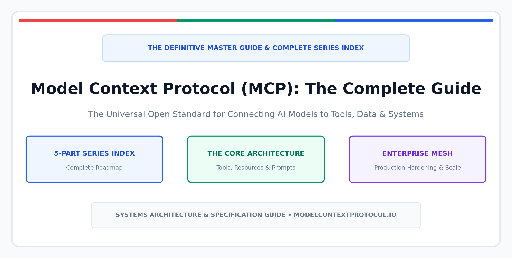
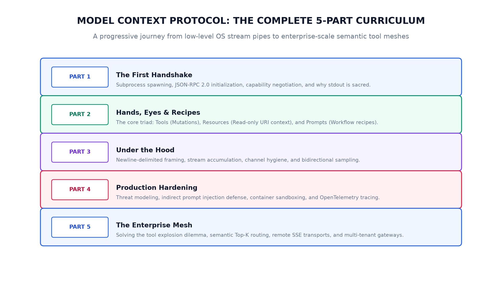

Connecting Large Language Models to real-world software systems has historically been one of the messiest frontiers in software engineering. 

Before late 2024, every AI provider—OpenAI, Anthropic, Google, and open-source runtimes—maintained proprietary function-calling formats. If you engineered an internal PostgreSQL tool, a Jira connector, or a GitHub pull-request reviewer, you were forced to write and maintain custom glue adapters for every single AI host or IDE.

This fragmented $M \times N$ integration bottleneck changed permanently with the release of the [Model Context Protocol (MCP)](https://modelcontextprotocol.io/).

By establishing a universal, transport-agnostic open standard grounded in battle-tested systems principles—**OS stream pipes, JSON-RPC 2.0 framing, RFC 6570 URI routing, and Server-Sent Events**—MCP does for AI agent systems what the **Language Server Protocol (LSP)** did for modern code editors.

This comprehensive guide serves as the **definitive architectural manifesto and complete master index** for our in-depth 5-part technical deep-dive into the Model Context Protocol.

---

## The Core Architectural Mental Model

Before diving into individual protocol primitives or wire mechanics, systems architects must internalize one central mental model:

$$\text{MCP Server} = \text{Traditional Backend Service} + \text{MCP Adapter}$$

$$\text{MCP Adapter} = \text{Traditional API Client} + \text{MCP Protocol Contract}$$

An MCP server does not replace your existing microservice infrastructure, relational databases, or cloud APIs. The underlying backend service remains 100% agnostic to AI, LLMs, or prompt engineering. The **MCP Adapter** acts purely as a protocol translation layer, exposing your service's capabilities, data streams, and workflows to AI clients over a standardized JSON-RPC interface.

---

## The 5-Part Master Curriculum & Index

Our comprehensive series walks through every layer of the protocol lifecycle—from low-level OS file descriptors to multi-tenant enterprise meshes:

---

### [Part 1: The First Handshake](https://blogs.ashokmurugan.com/mcp-part-1-the-first-handshake)
*Published: November 1, 2026*

The foundational guide exploring how an AI client (such as Claude Desktop or Cursor) launches an MCP server as an operating system child subprocess:
* **The $M \times N$ Integration Problem**: Why custom point-to-point wrappers fail at scale.
* **The OS Subprocess Architecture**: Why standard I/O pipes (`stdin` and `stdout`) are used instead of local HTTP ports.
* **The 4-Step Handshake Lifecycle**: Initializing session capabilities, protocol version negotiation (`2024-11-05`), and confirming readiness via `notifications/initialized`.
* **The Golden Invariant of Stdio**: Why **stdout is strictly sacred** and why all logging must route to `stderr`.
* **Hands-On Reference Implementation**: A complete Python FastMCP adapter connecting to a backend REST service.

---

### [Part 2: Hands, Eyes, and Recipes](https://blogs.ashokmurugan.com/mcp-part-2-hands-eyes-and-recipes)
*Published: November 3, 2026*

A semantic deep-dive into the three foundational primitives that define the protocol:
* **Tools (The Hands)**: Executable verbs with active side effects (`tools/list` and `tools/call`). Governed by JSON Schema validation and human-in-the-loop approvals.
* **Resources (The Eyes)**: Contextual nouns and read-only data streams. Addressed via RFC 6570 URI templates (`tasks://all`, `tasks://status/{status}`) for passive context hydration without wasting LLM reasoning tokens.
* **Prompts (The Recipes)**: Reusable, user-initiated workflow playbooks (`prompts/get`) surfaced as slash commands (`/daily_standup`) in host chat interfaces.
* **The Architectural Decision Matrix**: Rubric for choosing whether a capability belongs as a Tool, a Resource, or a Prompt based on initiator, token cost, and side effects.

---

### [Part 3: Under the Hood: JSON-RPC & Stdio Transport](https://blogs.ashokmurugan.com/mcp-part-3-under-the-hood-json-rpc-and-stdio-transport)
*Published: November 5, 2026*

Peeling back SDK decorators to examine the bare-metal wire format and process boundaries:
* **Why OS Stdio Over Localhost HTTP?**: Eliminating TCP port collisions, preventing browser DNS rebinding attacks, and leveraging OS kernel-managed lifecycle cleanup (`SIGPIPE` / `EOF`).
* **Channel Hygiene Across 3 Streams**: Managing `stdin` (requests), `stdout` (sacred protocol wire), and `stderr` (diagnostic telemetry sink).
* **Newline-Delimited Framing**: Stream buffer chunking (`4096-byte` reads) and line-buffering accumulators.
* **The Three Wire Archetypes**: JSON-RPC Requests, Responses, and Notifications.
* **Bidirectional RPC Inversion**: Server-initiated capabilities including **Sampling** (`sampling/createMessage`) and **Roots Discovery** (`roots/list`).
* **Protocol vs. Domain Errors**: Distinguishing wire-level transport errors (`code: -32601`) from model-recoverable application errors (`isError: true`).
* **Zero-Dependency Harness**: A pure standard-library Python client and server with zero third-party dependencies.

---

### [Part 4: Production Hardening: Security, Sandboxing & Observability](https://blogs.ashokmurugan.com/mcp-part-4-production-hardening-security-sandboxing-and-observability)
*Published: November 7, 2026*

Transitioning from local developer prototypes to high-stakes enterprise production:
* **The AI Agent Threat Model**: Mitigating Indirect Prompt Injection, Confused Deputy exploits, and data exfiltration.
* **The 4 Defense in Depth Rings**: Input schema boundary constraints, Human-in-the-Loop (HITL) authorization gates, container sandboxing, and audit logging.
* **Kernel-Level Container Sandboxing**: Production Docker/Bubblewrap configurations (`--network=none`, `--read-only`, `--cap-drop=ALL`, `--user=nobody:nogroup`, `--tmpfs`).
* **Rate Limiting & Circuit Breaking**: Sliding-window limiters preventing recursive AI tool execution loops and token starvation.
* **End-to-End Distributed Tracing**: Propagating W3C `traceparent` headers across stdio boundaries into downstream microservices with OpenTelemetry.

---

### [Part 5: The Enterprise MCP Mesh: Scaling to Hundreds of Tools](https://blogs.ashokmurugan.com/mcp-part-5-the-enterprise-mcp-mesh-scaling-to-hundreds-of-tools)
*Published: November 9, 2026*

Scaling agent platforms across enterprise infrastructure:
* **The Tool Explosion Problem**: Why dumping 500+ tool schemas into prompts causes context bloat (50,000+ tokens), 4.5s+ latency, and hallucinations.
* **Semantic Top-K Tool Routing**: Dynamic vector similarity selection injecting only the 4–6 most relevant tools per turn (97% token reduction).
* **Remote Transports via Server-Sent Events (SSE)**: Asymmetric wire protocol (`GET /sse` persistent downlink + `POST /message` uplink) traversing enterprise API gateways and corporate proxies.
* **Dynamic Capability Updates**: Utilizing `tools/list_changed` notifications for live, zero-downtime microservice registration.
* **The Enterprise Mesh Topology**: Client Tier $\to$ Central MCP Gateway $\to$ Federated Cloud Microservices.

---

## Architectural Decision Rubric

When designing your enterprise AI systems, use this reference matrix to select the appropriate transport, primitives, and isolation bounds:

| Dimension | Developer Workstation | Enterprise Production Cluster |
| :--- | :--- | :--- |
| **Primary Transport** | Local Stdio Pipes (`stdin`/`stdout`) | Remote Server-Sent Events (SSE) / Streamed HTTP |
| **Process Model** | Subprocess spawned by AI Host | Containerized Pods in Kubernetes (EKS/GKE) |
| **Tool Catalog Size** | 5 – 25 Tools | 100 – 500+ Federated Microservice Tools |
| **Routing Strategy** | Static Schema Injection in Prompt | Dynamic Semantic Top-K Vector Router |
| **Security Isolation** | Local User Permissions / Docker Sandbox | Seccomp, Read-Only RootFS, Air-Gapped Network |
| **Observability** | `sys.stderr` console output | OpenTelemetry Spans + W3C `traceparent` propagation |
| **Lifecycle Updates** | Restart client host | Live `tools/list_changed` SSE push notifications |

---

## GitHub Companion Code Repositories

Every architectural pattern and diagram across this series is backed by production-tested, runnable companion code:

* **[Part 1 Companion Code](https://github.com/ashok-murugan/ashok-murugan-blogs/tree/main/mcp-part-1-the-first-handshake/assets)**: FastMCP adapter, Go REST backend, and stdio pipes harness.
* **[Part 2 Companion Code](https://github.com/ashok-murugan/ashok-murugan-blogs/tree/main/mcp-part-2-hands-eyes-and-recipes/assets)**: Complete implementation of Tools, Resources, and Prompts tested with the official MCP Inspector.
* **[Part 3 Companion Code](https://github.com/ashok-murugan/ashok-murugan-blogs/tree/main/mcp-part-3-under-the-hood-json-rpc-and-stdio-transport/assets)**: Zero-dependency Python standard-library client and server.
* **[Part 4 Companion Code](https://github.com/ashok-murugan/ashok-murugan-blogs/tree/main/mcp-part-4-production-hardening-security-sandboxing-and-observability/assets)**: Rate-limited, sandboxed FastMCP server with structured audit telemetry.
* **[Part 5 Companion Code](https://github.com/ashok-murugan/ashok-murugan-blogs/tree/main/mcp-part-5-the-enterprise-mcp-mesh-scaling-to-hundreds-of-tools/assets)**: Central Enterprise Gateway and Semantic Router with dynamic intent switching.

---

## Conclusion: Architecting for the Agentic Era

We are transitioning from the era of **passive conversational chatbots** into the era of **autonomous, agentic software engineering**. 

In this new paradigm, an AI model is only as effective as the tools it can wield, the context it can inspect, and the security guardrails that bound its execution.

By standardizing on the **Model Context Protocol**, engineering organizations decouple model intelligence from enterprise infrastructure. You write your system adapters once, govern them with enterprise-grade authorization and observability, and empower any AI client—today and in the future—to safely collaborate with your software.
